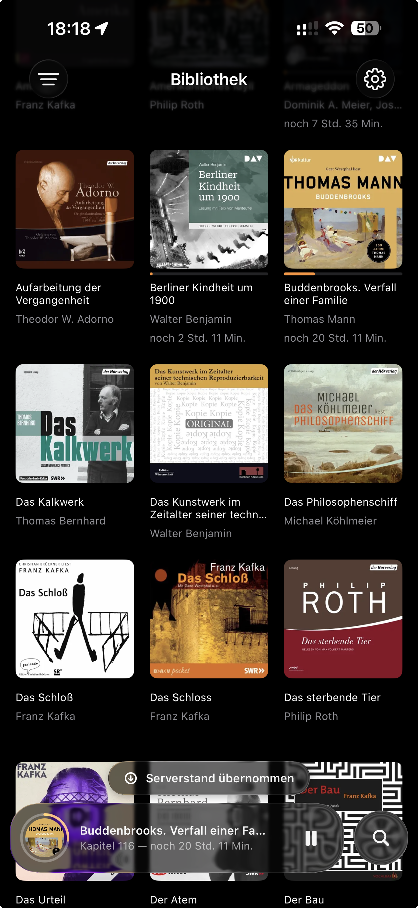
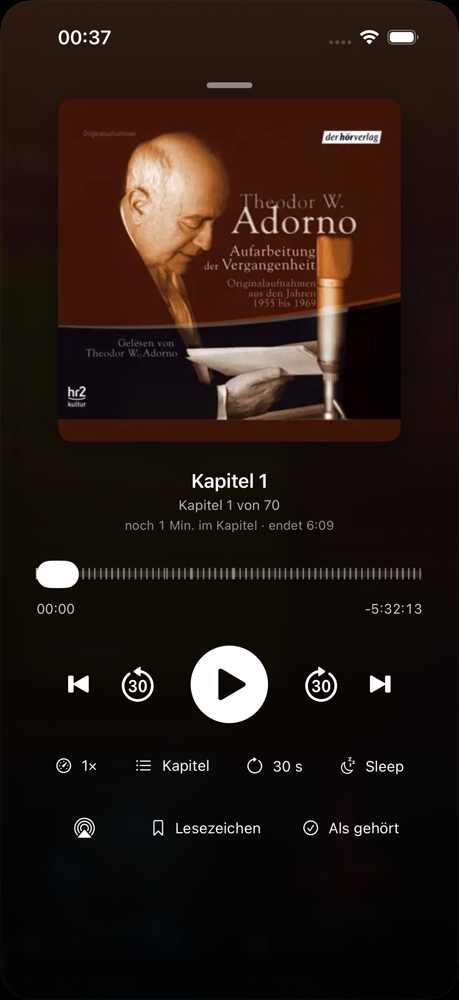
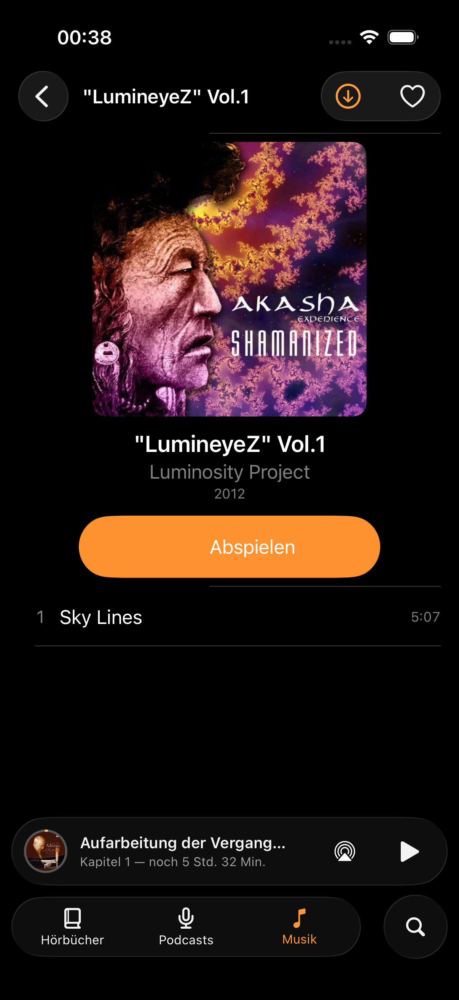
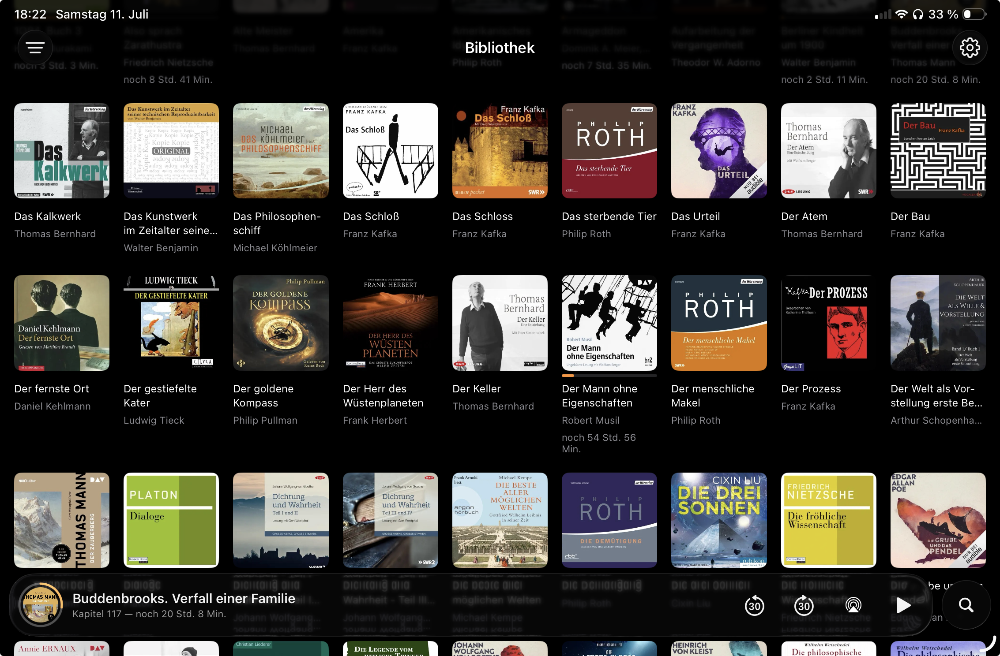
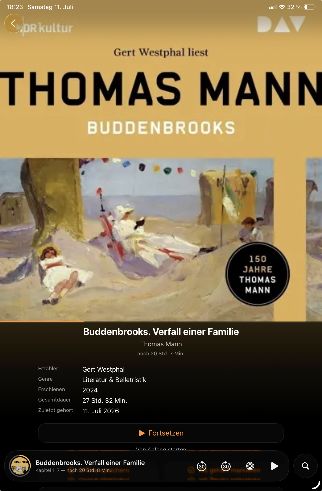
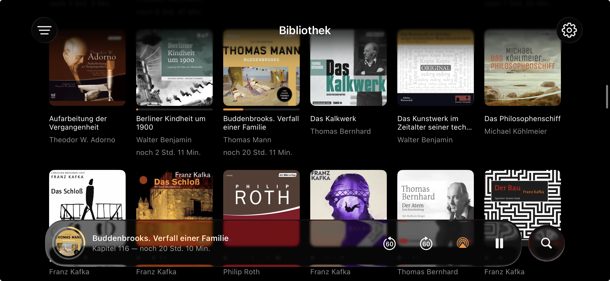
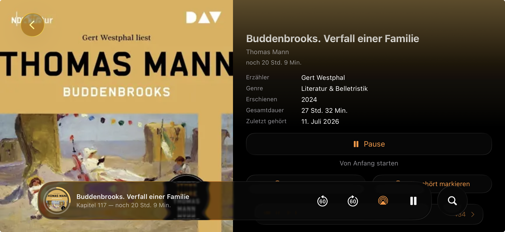

<p align="center">
  
</p>

# Mär

Ein schlanker, quelloffener iOS-/iPadOS-Client für **selbst gehostetes Audio**: Hörbücher, Podcasts, Musik und Internetradio in einer App, mit einer Designsprache und einem Player.

Mär ist **server-first und offline-first**: Bibliothek, Metadaten, Cover und Fortschritt liegen auf deinen eigenen Servern und erreichen die App über **offene Standard-APIs ohne clientseitige API-Keys**: [Audiobookshelf](https://www.audiobookshelf.org/), Subsonic/OpenSubsonic, Jellyfin, gpodder/mygpo, klassisches RSS (einschließlich der Kanal-Feeds, die eine Pinchflat-Instanz spiegelt) und den offenen Radio-Browser-Katalog. Sein Fundament ist **verlässlicher Fortschritts-Sync** über mehrere Geräte hinweg, ohne dass ein Buch versehentlich auf 0 zurückgesetzt wird, auch komplett offline.

> „Mär“ ist ein altes deutsches Wort für Erzählung oder Geschichte, passend für einen Audio-Player. Das Xcode-Projekt ist `Maer.xcodeproj`; „Mär“ mit Umlaut ist der Anzeigename.

Entstanden als privater Ersatz für einen Client, der beim Gerätewechsel regelmäßig den Hörfortschritt verlor. Inzwischen ist daraus ein universeller Client für das selbst gehostete, quelloffene Audio-Ökosystem geworden, auf einer Provider-Architektur, dabei bewusst fokussiert: kein Multi-User, keine Server-Verwaltung, nur hören und den Stand verlässlich synchron halten, online wie offline.

> **Hinweis:** Dies ist ein privates Hobby-Projekt ohne Gewähr. Es ist nicht mit dem Audiobookshelf-Projekt verbunden.

**Zuhause:** <https://maer.fm> · **Quelltext:** <https://codeberg.org/LzS/maer>

## Privatsphäre & Datensicherheit

Was das Gerät verlässt, wohin es geht und was bleibt. Jede Aussage unten lässt sich in diesem Repository prüfen.

- **Kein Konto bei diesem Projekt.** Mär hat keine Registrierung, keinen eigenen Dienst und keine Nutzerdatenbank. Es meldet sich nur dort an, wo du eine Anmeldung einträgst: bei deinen eigenen Servern, bei einem Mär-Sync-Dienst, den du selbst betreibst, bei einem Premium-Podcast-Feed und, einmal für einen Import, bei Pocket Casts.
- **Kein Tracking.** Keine Analytics, keine Werbung und keine Dritt-SDKs: das Projekt hat keine externen Code-Abhängigkeiten. Builds aus Xcode und TestFlight behalten die täglichen MetricKit-Berichte auf dem Gerät für eine Messseite und senden sie nirgendwohin; App-Store-Builds empfangen sie nicht. Um die Builds zu unterscheiden, fragt eine Installation aus TestFlight oder dem App Store beim Start Apples App Store, welche Umgebung sie signiert hat.
- **Auf dem Gerät.** Hörstände, Abos, Playlisten, Statistik, der Hörverlauf und die Bibliothek liegen in einer Datenbankdatei; Downloads sind Dateien daneben; Anmeldungen liegen im Schlüsselbund. Das Protokoll der Wiedergabe-Meldungen hält höchstens 200 Zeilen der letzten sieben Tage in einer eigenen Datei und verlässt das Gerät nicht. Was zwischen deinen Geräten reist, nennen die nächsten drei Punkte.
- **Anfragen an fremde Dienste, jeder mit Schalter.** Jeder fremde Dienst, der nicht einer deiner eigenen Server ist, hat seinen eigenen Schalter unter Einstellungen → Externe Quellen & Privatsphäre, die elf beim Namen: LibriVox, Project Gutenberg, Internet Archive, Jamendo, Podcast Index, Apple Podcasts, Radio Browser, Wikidata / Wikimedia Commons, MusicBrainz / Cover Art Archive, LRCLIB und Cover von Podcast-Hosts. Podcast Index steht dort nur, wenn ein Schlüssel gesetzt ist, der eingebaute oder dein eigener; ohne Schlüssel nimmt die Podcast-Suche Apples Verzeichnis. Jeder Schalter sagt, was er speist und was beim Ausschalten bleibt. Welche Reihen auf den Tabs erscheinen, ist eine eigene Frage und wird unter Einstellungen → Reihen beantwortet. Die optionalen eingebauten App-Schlüssel für Jamendo und Podcast Index weisen die App gegenüber diesen Diensten aus, nicht dich. Außerhalb dieser Seite spricht die App mit Pocket Casts während eines Imports, den du startest, und mit Apples App Store für die oben genannte Prüfung.
- **iCloud, an, solange du es nicht ausschaltest.** Der Schalter „iCloud“ unter Einstellungen, Sync steht von Anfang an auf an und wirkt auf einem Gerät, das bei iCloud angemeldet ist. Über die private Datenbank von iCloud (CloudKit), je ein Datensatz: Hörstände von Podcasts, Katalog-Titeln und lokalen Dateien; deine Hörstatistik; deine Mär-Playlisten; und deine Wahlen: die Podcast-Abos mit ihren Feed-Adressen, Premium-Markierungen und gesperrte Feeds, Sortierungen und Filter, Radio-Favoriten und die Sender, die du eingetragen hast, letzte Suchen und Sender, ausgeblendete Titel, der zuletzt gespielte Titel, Wiedergabegeschwindigkeiten und Sprungweiten, Darstellung, Benachrichtigungs-Einstellungen, Tab-, Quellen- und Reihen-Einstellungen, Einstellungen je Sendung und die Adressen von Servern, die einmal funktioniert haben (nie ihre Anmeldungen), damit dein anderes Gerät sie unter seinem Adressfeld anbieten kann. Über Apples Schlüsselwert-Speicher: die Markierung „läuft auf einem anderen Gerät“; die Datensätze oben, solange das Gerät kein iCloud-Konto hat, vor der ersten CloudKit-Runde und wenn CloudKit einen Schrieb verweigert; und was ein Gerät mit einem älteren Build dort schreibt, wird gelesen. Die Anmeldungen von Premium-Feeds reisen im iCloud-Schlüsselbund. Eine Feed-Adresse, die ihren Token trägt, behält ihn und reist mit den Abos. Die Anmeldungen deiner Server bleiben auf dem Gerät. Diese Daten gehen unter deinem Konto und Apples Bedingungen an Apple.
- **Ein eigener Sync-Dienst, nur wenn du einen einrichtest.** Unter Einstellungen, Sync lässt sich Mär auf einen Mär-Sync-Dienst richten, den du selbst betreibst (eigenes Repository, [maer-sync](https://codeberg.org/LzS/maer-sync), eine SQLite-Datei, und seit v0.2.0 zwei Umsetzungen eines Vertrags: der Rust-Build ist der, der ausgerollt wird, die Python-Fassung bleibt als Rückweg im Baum). Die Anmeldung fragt den Dienst nach seinem Schlüssel und dem Salz des Kontos und sendet nur einen Beweis, der aus dem Passwort gebildet wird; das Passwort selbst reist nicht und wird nicht behalten, und der Token, den der Dienst zurückgibt, bleibt im Schlüsselbund dieses Geräts. Vom Moment der Anmeldung bis zur Abmeldung reisen statt über iCloud zum Dienst: Hörstände von Podcasts, Katalog-Titeln und lokalen Dateien, die Wiedergabe-Markierung, die Hörstatistik, deine Mär-Playlisten und deine Wahlen mit den Abos, dazu die Anmeldungen von Premium-Feeds, versiegelt für deine anderen Geräte. Die Dokumente sind unterwegs verschlüsselt und werden auf deinem Host so gespeichert, wie sie ankommen; versiegelt sind dort nur die Feed-Anmeldungen. Der Dienst sagt deinem anderen Gerät Bescheid, wenn sich etwas ändert, statt zu warten, bis es fragt. Dieses Projekt betreibt keinen solchen Dienst. Ein Schrieb, den der Dienst verweigert, steht auf der Sync-Seite mit dem eigenen Satz des Dienstes.
- **Anmeldungen und wo sie sichtbar werden.** Server-Passwörter, Tokens und Schlüssel liegen im Schlüsselbund dieses Geräts; die Anmeldungen von Premium-Feeds reisen wie oben genannt. Manche Server nehmen ihren Token in der Adresse einer Anfrage, also steht er in den Logs dieses Servers und jedes Proxys davor: Audiobookshelf in Cover- und Autorenbild-Links, Subsonic in jeder Anfrage, Jellyfin in Stream- und Cover-Links, Pinchflat in der Adresse der Kanalliste. Die eigenen Logs der App tragen Hosts, Kennungen von Titeln und öffentliche Stream-Adressen, keinen Token. Der OPML-Export lässt Premium- und Token-Feeds standardmäßig weg.
- **Import aus anderen Apps.** Importe aus Apple Podcasts, Overcast, AntennaPod und OPML-Dateien lesen eine Datei, die du auf dem Gerät auswählst. Der Pocket-Casts-Import meldet sich einmal mit der E-Mail-Adresse und dem Passwort, die du einträgst, bei Pocket Casts an, liest die Abos und Hörstände deines eigenen Kontos und verwirft die Anmeldung, wenn er fertig ist; er nutzt eine Schnittstelle, die Pocket Casts nicht offiziell dokumentiert. Importierte Abos reisen danach wie jedes andere Abo.
- **Lies den Code.** Mär steht unter GPL-3.0-or-later mit zusätzlichen Bedingungen (siehe Lizenz unten); jede Aussage oben lässt sich in diesem Repository prüfen.

## Screenshots

| Bibliothek | Player | Musik |
|---|---|---|
|  |  |  |

| Bibliothek (iPad) | Buchseite (iPad) |
|---|---|
|  |  |

| Bibliothek (Querformat) | Buchseite (Querformat) |
|---|---|
|  |  |

## Funktionen

- Anmeldung mit Benutzername/Passwort oder API-Token, kompatibel mit dem alten und dem neuen Anmeldesystem von Audiobookshelf
- Bibliothek als adaptives Cover-Raster für iPhone und iPad, das sich immer an die tatsächliche Bildschirmbreite anpasst, ohne Überlappung, auch beim Drehen
- **Globale Suche über alle Quellen**: eine Suche erreicht Hörbücher, Podcasts, Musik und Radio zugleich. Eine stehende Bereichsleiste grenzt sie auf Bibliothek / Hörbücher / Podcasts / Musik / Radio ein; ein leeres Feld zeigt ein Stöber-Deck (letzte Suchen und Einstiegskacheln für Autoren/Serien/Genres, Künstler, Sendungen, Alben); beim Tippen kommen gewichtete Ergebnisse je Typ. Die Podcast- und Radio-Bereiche nehmen einen Katalog-Abschnitt dazu („Neue Sendungen“ aus PodcastIndex/iTunes, Sender aus Radio Browser), damit du etwas abonnieren oder abspielen kannst, das du noch nicht hast. Offline-fähig: jede Quelle durchsucht ihren gespeicherten Inhalt, und Ergebnisse, die gerade nicht spielbar sind, sind gedimmt und markiert. Ein Autor, eine Serie oder die Autoren, Serien oder Genres der Bibliothek, aus der Suche geöffnet, öffnen ihre Seite im Hörbuch-Tab, und zurück führt in die Suche mit Anfrage und Ergebnissen
- **Start ohne Server**: der erste Bildschirm zeigt die Karte der Bereiche; Radio, Podcasts (RSS), die freien Kataloge und lokale Dateien gehen sofort, und Server (Audiobookshelf, ein Musikserver, gpodder-Sync, ein Mär-Sync-Dienst) kommen später einzeln unter Einstellungen dazu, wo dieselbe Karte steht. Der Einrichtungsbildschirm und die Nächsten Schritte nennen jeden Server, mit dem Mär getestet ist, jeder mit einer kurzen Seite: was er tut, was er braucht, was du in Mär einträgst, und Links zu seiner Dokumentation und seinem Quelltext
- **Start-Tab**: ein medienübergreifender Startbildschirm mit den Reihen Weiterhören, Als Nächstes, Wieder anhören (die Musik, die du angefangen hast: Alben, Playlisten, Songs), Neueste Folgen, Zuletzt hinzugefügt, Wiederentdecken (eine Weile pausiert / nächstes unbeendetes Buch einer Serie), Empfohlen und Entdecken-Reihen für Musik und für Hörbücher und Hörspiele; jede Reihe lässt sich unter Einstellungen → Reihen ausschalten
- **Freie Kataloge** (von Anfang an da, jede Reihe lässt sich ausschalten): Reihen aus dem offenen Audio-Gemeingut: Hörbücher von LibriVox und Internet Archive, Project Gutenberg, alte Hörspiele, Netlabel-Musik, digitalisierte 78er-Schallplatten, Jamendo (mit Schlüssel), mit Genre-Regalen, täglich wechselnden beliebten Reihen und einer ehrlichen Rechte-Kapsel je Titel, die nie rät
- Sortierung nach Titel, Autor, zuletzt hinzugefügt oder zuletzt gehört, auf- oder absteigend; Sortier- und Filterwahl bleiben über App-Starts erhalten
- Filter für alle/unbeendete/beendete/geladene Bücher
- Abschnitte „Weiterhören“, „Geladen“, „Zuletzt hinzugefügt“ und „Alle Bücher“; mit Server eine Kachel-Leiste für Serien, Autoren, Lokale Dateien und Hörverlauf (Serien und Autoren öffnen eine Seite mit jeder Gruppe und ihrer Zahl, eine Gruppe öffnet ihre Bücher); ohne Server stehen Lokale Dateien und Hörverlauf als Zeilen
- Haptic-Touch-Kontextmenü auf Covern für schnelle Aktionen: abspielen, als Nächstes spielen, zuletzt spielen, als gehört oder ungehört markieren und einen Titel aus Weiterhören ausblenden
- Fortschrittsbalken, „Beendet“-Haken und Download-Badge direkt auf jedem Cover; beendete Bücher erscheinen grau
- Buchseite mit Beschreibung, Sprecher, Serie, Genres, Erscheinungsjahr und Gesamtdauer; Download und „Als gehört markieren“ direkt auf der Buchseite, mit einem Play/Pause-Knopf, der eine schon laufende Sitzung richtig zeigt und steuert
- Stehende schwebende Mini-Leiste im Stil von Apples Liquid Glass (auf iOS 26 und neuer; ältere Systeme bekommen das System-Material), mit kreisförmigem Fortschrittsring ums Cover; die Sprungknöpfe erscheinen, wenn die Leiste mindestens 360 Punkte breit ist, und fallen im iPhone-Hochformat weg, damit mehr Platz für den Titel bleibt, AirPlay bleibt; stellt nach einem vollen App-Neustart die letzte Hörsitzung wieder her, pausiert und ohne selbst zu starten
- Voller Player als abgerundetes Liquid-Glass-Blatt über der Bibliothek. Nach unten ziehen (Griff oder seitliche Zonen) schließt zurück zur Mini-Leiste, die Bibliothek scheint beim Ziehen durch das Glas; großes Cover, Verlauf aus der Cover-Farbe, Kapitelmarken direkt auf dem Schieber, Play/Pause/Spulen, einstellbare Sprungweite (15/30/60 s für Sprache, 5/10/15/30 s für Musik, auch für Sperrbildschirm und Mini-Leiste), Geschwindigkeit je Buch gemerkt, Schlaf-Zeitgeber mit festen Minuten oder bis Kapitelende, AirPlay, „Als gehört“ und dezentes haptisches Feedback; im Querformat (iPhone und iPad) steht das Cover neben den Bedienelementen
- Glas-Pille für Wiedergabe- und Sync-Meldungen über der Mini-Leiste oder im vollen Player: eine kurze Meldung („Serverstand übernommen“, „Konflikt erkannt“) blendet sich nach ein paar Sekunden aus, eine Meldung, die die Wiedergabe angehalten hat (ein Titel, der nicht laden konnte, ein unlesbarer Download ohne Netz), bleibt bis zum nächsten Start, und „Wartet auf das Netz …“ bleibt, bis der Strom wieder läuft; Routine-Meldungen wie „Fortschritt gesichert“ gehen nur ins Protokoll. Ein Tipp auf die Pille öffnet das Protokoll der letzten Meldungen mit Titel und Zeit, auch unter Einstellungen → Meldungen; es hält höchstens 200 Zeilen aus sieben Tagen auf diesem Gerät. Im vollen Player steht die Pille im freien Platz neben der Bedienung und verdeckt nie einen Knopf
- Hintergrund-Audio, Sperrbildschirm und Dynamic Island mit Cover
- **Mehrspur-Wiedergabe**: Hörbücher aus mehreren Audiodateien (nicht zu einer M4B zusammengefügt) laufen nahtlos hintereinander, mit richtigen Kapiteln und Fortschritt über das ganze Buch
- **Offline-Download** je Buch, von Hand gestartet, mit WLAN-Warnung; lädt jede Spur eines Buches, nicht nur die erste, läuft im Hintergrund weiter, zeigt einen Fortschrittsring auf dem Cover-Badge und speichert Kapitel und Metadaten lokal. Ein geladenes Buch öffnet und spielt komplett offline, ohne den Server nur für die Kapitelliste zu brauchen
- **Offline-Bibliothek**: ist der Server nicht erreichbar, zeigt die Bibliothek weiter jedes Buch aus ihrer Datenbank, die nicht geladenen gedimmt und ein Banner, das es sagt; Cover geladener Bücher werden dauerhaft gespeichert und überstehen das Aufräumen des iOS-Caches; Cover, die größer sind, als das Gerät braucht, werden einmal verkleinert und als JPEG behalten
- **Offline-Sync-Warteschlange**: eine Fortschritts-Meldung, die nicht ankommt, ob offline oder wegen eines Serverfehlers, wird in die Datenbank der App eingereiht (der Eintrag steht, bevor der Aufruf zurückkehrt, also behält ihn auch eine App, die gleich danach beendet wird) und beim nächsten Start oder sobald die Verbindung zurück ist, wieder versucht; vor dem Abarbeiten gleicht die Warteschlange mit dem Server ab, damit ein veralteter Stand nie einen neueren eines anderen Geräts überschreibt
- Automatisches Erkennen der zurückgekehrten Verbindung: Bibliothek und eingereihte Sync-Meldungen frischen sich selbst auf, ohne die App in den Hintergrund und zurück zu holen
- **Sicherer Fortschritts-Sync**; siehe Die Sync-Kernregel unten
- Abgleich des Fortschritts über mehrere Geräte
- Ein Titel, von dem nur noch etwa die letzte Minute übrig ist, gilt als gehört: Wischen, Menüs und Knöpfe bieten an, ihn zu markieren, und er erscheint als gehört
- **Mär-Playlisten**: eigene Playlisten, die Titel aus verschiedenen Quellen mischen und als eigener Datensatz zwischen deinen Geräten reisen (iCloud oder dein eigener Sync-Dienst)
- **Lesezeichen** je Buch (Position + Titel), über die Lesezeichen-API von Audiobookshelf abgeglichen, im Player angelegt, mit Offline-Warteschlange: ohne Verbindung angelegte oder gelöschte Lesezeichen gehen von selbst hinaus, sobald sie zurück ist
- Einstellungen: Quellen und Sync je Dienst an einer Stelle unabhängig vom Tab, die Sync-Seite (iCloud oder ein eigener Mär-Sync-Dienst), Sprungweite, Standard-Geschwindigkeit für neue Bücher, **Smart Rewind** (nach längeren Pausen etwas früher weiter), **automatisch das nächste unbeendete Buch einer Serie**, Darstellung (System/hell/dunkel), WLAN-Download-Warnung, Speicherverwaltung, Benachrichtigungen, Hörstatistik und die App-Version. Die meisten dieser Wahlen reisen zwischen deinen Geräten; auf jedem Gerät für sich bleiben der iCloud-Schalter selbst, die Mobilfunk-Warnung, der Fahrmodus, der Schlaf-Zeitgeber und der zuletzt offene Tab
- **Sync-Verlauf** in den Einstellungen: eine Liste über alle Dienste (Audiobookshelf-Fortschritt, gpodder, iCloud, Musikbibliothek), mit einer Zeile „zuletzt geprüft“ je Dienst und einem Ring der echten Änderungen, Fehler und Massenlösch-Wächter; ein sauberer Lauf ohne Änderung bleibt sichtbar, ohne den Ring zu füllen
- **Fahrmodus**: ein Vollbild mit großen Knöpfen für die Halterung im Auto, von Hand oder automatisch, wenn sich deine gewählte Audio-Route im Auto verbindet, während Mär einen Player geladen hat (ohne zusätzliche Berechtigungen); der Bildschirm bleibt an, Siri-Kurzbefehl inklusive
- **Hörverlauf**: ein persönlicher Verlauf der gehörten Podcast-Folgen, der Abbestellen und Feed-Rotation übersteht, und eine Seite Hörverlauf für Bücher und für Musik: die Bücher, die du beendet hast, und die Songs, die du gehört hast (sobald die Hälfte eines Songs oder vier Minuten gelaufen sind), neueste zuerst; eine Zeile öffnet ihr Buch oder das Album des Songs. Er bleibt auf diesem Gerät
- Die App startet auf dem **zuletzt gewählten Tab**, und ein kurz nicht erreichbarer Server wirft dich nie von deinem Tab
- **Siri & Kurzbefehle**: „Weiterhören in Mär“, „*Buch* in Mär abspielen“ (die Buchnamen kommen aus den Bibliothekszeilen in der Datenbank der App) und „Mär Fahrmodus“, dazu eine Schnellaktion auf dem Home-Bildschirm, die das zuletzt gespielte Buch fortsetzt
- **CarPlay**: Hörbuch-Tabs (Weiterhören / Geladen / Bibliothek), dazu ein Podcast- und ein Musik-Tab, sobald diese Quellen eingerichtet sind, je mit Cover-Vorschauen und dem Now-Playing-Bildschirm des Systems, mit derselben Wiedergabe-Sitzung wie das Telefon. Geht auch bei einem Kaltstart im Auto, mit Rückfall auf den Offline-Cache; im Simulator sofort testbar, echte Autos brauchen Apples CarPlay-Audio-Berechtigung (developer.apple.com/contact/carplay)
- Adaptives helles und dunkles Design mit **dunkelgrauem Markenakzent**; jede Medienart trägt ihre eigene Farbe im Tab-Wähler: Hörbücher orange, Podcasts lila, Musik rot, Radio cyan. Das Liquid-Glass-Chrome (Mini-Leiste, Suche, Werkzeugknöpfe) nimmt im hellen Modus einen zarten Pastellton der aktuellen Cover-Farbe an, und die Mini-Leiste taucht beim Buchwechsel kurz ab und federt zurück
- Leistung: Raster-Zellen dekodieren ein kleines abgeleitetes Vorschaubild statt des vollen Covers, für flüssiges Scrollen und viel weniger Speicher bei großen Bibliotheken; große Cover werden auf ihre Anzeigegröße gebracht, bevor die App sie hält, zwei zugleich, und eine Kachel, die den Bildschirm verlassen hat, lädt ihr Cover nicht mehr; die Buchliste kommt im verkleinerten Format von Audiobookshelf; was die App zwischen zwei Sync-Runden hält (Stände, Wahlen, Playlisten und Statistik deiner anderen Geräte), liegt Zeile für Zeile in ihrer Datenbank, also schreibt ein Speichern während der Wiedergabe nur, was sich geändert hat
- **Barrierefreiheit**: volle Unterstützung von Dynamic Type bis zu den Bedienungshilfen-Größen: Bedienzeilen brechen in ein zweispaltiges Raster um, Kacheln fester Breite bekommen Zeilen dazu, und feste Maße skalieren über `@ScaledMetric`; VoiceOver-Beschriftungen an allen Bedienelementen und 44-pt-Trefferflächen; geprüft über Gerätegrößen von der 375-pt-Klasse bis zum iPad in beiden Ausrichtungen
- Härtung: Speicherplatz-Prüfung vor dem Download, Container-Erkennung über die ersten Bytes mit automatischer Reparatur der Dateiendung (mit Tests), automatische Erholung, wenn eine Spur mitten in der Wiedergabe ausfällt, statt stillem Stehenbleiben, ein Titel, der nicht laden kann, hält mit einem kurzen Hinweis an und lädt beim nächsten Tippen auf Play neu (und von selbst, ohne zu starten, wenn das Netz zurückkommt), eine geladene Datei, die nicht gelesen werden kann, läuft an derselben Stelle vom Server weiter und wird neu geladen, eine Spur, die mit weniger Bytes ankommt, als der Server nennt, gilt als fehlgeschlagener Download, nicht als fertiger, ein Strom, der nicht mehr liefert, zeigt „Wartet auf das Netz …“ und hält die Wiedergabe nie an, eine Liste, die nicht laden konnte, sagt es mit Erneut versuchen statt eines leeren Ergebnisses, VoiceOver-Beschriftungen an allen Transport-Knöpfen

## Podcasts

Version 2.0 macht Mär zu einem vollen **Podcast-Client** neben Hörbüchern. Podcasts sind eine eigene Medienart hinter demselben Provider-Protokoll, Hörbuch-Wiedergabe und -Sync bleiben unberührt; ein eigener Podcast-Tab ist von Anfang an an, lässt sich mit den anderen Tabs unter Einstellungen ausschalten und zeigt ohne Abos seinen eigenen leeren Zustand.

- **Abo-Quellen, abgeglichen:** lokale **RSS**-Feeds, zuschaltbare **Audiobookshelf**-Podcast-Bibliotheken, ein selbst gehosteter **gpodder/mygpo**-Server (z. B. [oPodSync](https://github.com/kd2org/opodsync)) als gleichrangiges Backend neben iCloud, einem Mär-Sync-Dienst und ABS, und die Kanalliste eines **Pinchflat**-Servers als eigene Gruppe. Abos, Abbestellungen und Abspielstand bleiben in einem sauberen, abgeglichenen Zustand über alle hinweg; ein robustes Abbestellen entfernt einen Feed aus jeder Quelle zugleich
- **Import aus anderen Podcast-Apps, mit deinen Hörständen:** Apple Podcasts (die vom Mac geholte `MTLibrary.sqlite`), Overcast (sein erweiterter OPML-Export), AntennaPod (sein Datenbank-Export), Pocket Casts (dein eigenes Konto, E-Mail und Passwort, einmal gelesen, nichts gespeichert) und einfaches OPML. Abos und Hörstände kommen nach einer Regel mit: wo beide Seiten einen Zeitpunkt tragen, gewinnt der neuere Stand; ein Stand ohne Zeitpunkt füllt nur Lücken; eine gehörte Folge wird nie zurückgenommen; eine archivierte Folge gilt als gehört. Jeder Import zeigt zuerst eine Vorschau und nennt, was er nicht zuordnen konnte
- **Export mit Hörständen:** der OPML-Export schreibt deine Positionen und Gehört-Marken in dem erweiterten Format, das Overcast liest, mit einer `guid` je Folge, damit Mär seine eigene Datei auf einem anderen Gerät vollständig zurückliest; Premium-Feeds bleiben samt ihren Ständen draußen
- **Startseite im Stil von Apple Podcasts:** eine Reihe „Weiterhören“ aus großen Karten (Restzeit · zuletzt gehört · Kapitel), nutzungsbasierte Empfehlungen, die Als-Nächstes-Warteschlange, eine Premium-Reihe, geladene Folgen und ein Sendungs-Raster „Abos“, dessen rotes Badge alle ungehörten Folgen zählt, wie bei Apple Podcasts und Pocket Casts; Einstellungen → Podcasts bietet stattdessen „neu seit zuletzt gehört“ oder aus
- **Nutzungsbasierte Empfehlungen:** sprachbewusst und thematisch aus deiner eigenen Bibliothek und Hörzeit, erweitert über Autor/Verlag und reihum gemischt, damit kein einzelner Verlag überwiegt; jeder Vorschlag sagt, aus welcher deiner Sendungen er kommt, und Sendungen, die du gehört hast, ohne ihnen zu folgen, bekommen eine eigene Reihe „Mitgehört“
- **Einstellungen je Sendung:** Eingangs-Modus, automatischer Download neuer Folgen und Benachrichtigungen über neue Folgen je Sendung
- **Premium-Feeds** über HTTP-Basic-Auth je Feed, im Schlüsselbund gespeichert
- **Reiche Metadaten** aus RSS / Podcasting 2.0 und der PodcastIndex-API: Staffeln, Folgentyp, Explizit-Markierung, Gäste/Personen, Transkripte, Unterstützungs-Links, Kategorien
- **Hintergrund-Aktualisierung** (`BGAppRefreshTask`) mit einer Benachrichtigung je Aktualisierung, die die Sendungen mit neuen Folgen nennt, Offline-Downloads, eine Wiedergabe-Warteschlange, Kapitel, Transkripte im Player, hochaufgelöste Feed-Cover, CarPlay und die Home-Bildschirm-Widgets „Als Nächstes“ und „Weiter hören“, die Bücher, Musik und Folgen zeigen
- Brücke des Hörverlaufs zwischen RSS- und ABS-Podcast-Folgen (gemeinsamer Fortschritt, optionales Hochschreiben zum Server)
- **Kapitel und Werbung, eine ehrliche Grenze:** Kapitel kommen nur aus `podcast:chapters` (nicht aus PSC-Tags im Feed, nicht aus ID3-`CHAP`-Frames in der Datei). Mär erkennt keine Werbung. Sendungen, die Werbung beim Download einfügen, liefern jedem Gerät eine andere Datei, also kann die Position einer Folge zwischen deinen Geräten um die Länge der eingefügten Werbung abweichen; die App kann Werbung nicht von der Folge unterscheiden

## Musik

Version 2.1 bringt **Musik** als dritte Medienart, für **Subsonic / OpenSubsonic**-kompatible Server (Navidrome, gonic, Airsonic). Wie Podcasts steht sie hinter demselben Provider-Protokoll, Hörbuch- und Podcast-Wiedergabe bleiben unberührt; der Musik-Tab ist von Anfang an da, mit den freien Reihen für Netlabels und alte Schallplatten (und Jamendo, sobald ein Schlüssel gesetzt ist), und dein eigener Server kommt dazu, sobald er im Musik-Bereich der Quellen-Karte in den Einstellungen eingerichtet ist.

- **Eigenes Stöbern je Medienart** (nicht das Hörbuch-Raster): große Playlist-Karten mit echtem Cover-Mosaik oben, eine gruppierte Bibliotheksliste (Künstler · Alben · Songs · Playlisten · Genres · Geladen · Hörverlauf) und Regale „Zuletzt gespielt“ / „Zuletzt hinzugefügt“. Ein Album ist ein Mehrspur-Titel: ein Tipp auf einen Song spielt das ganze Album ab dieser Stelle über denselben Player wie alles andere.
- **Playlisten**: Server-Playlisten anlegen, umbenennen und löschen; Songs oder ganze Alben aus jedem Kontextmenü hinzufügen („Zur Playlist hinzufügen“, mit Ablauf für eine neue Playlist); Zeilen genau nach Index entfernen. Weiterhören geht für Playlisten UND Alben (Server-Lesezeichen bei Subsonic, geräteübergreifend).
- **Jellyfin** als zweites Musik-Backend hinter derselben Oberfläche: Alben, Künstler, Playlisten, Suche, Songtexte, Favoriten. Sind ein Subsonic-Server und Jellyfin beide eingerichtet, fragt Musik beide nach jeder Liste und spielt jeden Titel von seinem eigenen Server. Im täglichen Gebrauch.
- **Jellyfin-Hörbücher (gemessen gegen Jellyfin 12)**: eine Bibliothek mit `CollectionType: books` erscheint als Hörbuch-Bibliothek, und ihre Einträge spielen mit einer echten Hörposition, die zum Server und zurück reist. Jellyfin 12 führt jede Datei eines Hörbuch-Ordners als eigenen Eintrag; Mär faltet die Dateien eines Ordners mit demselben Album-Tag zu **einem Buch**, in Spur-Reihenfolge, mit einer Position, die über Dateien, Neustarts und dein anderes Gerät trägt. Dateien mit anderem Tag oder ohne Tag bleiben eigene Bücher, also hält ein Ordner mit mehreren Einzeldatei-Büchern sie auseinander. **Eine gemessene Grenze, und sie liegt beim Server:** es gibt **keine Kapitel** (Jellyfin erzeugt für `AudioBook` keine). Die Hörposition reist über `UserData`, nicht über Wiedergabe-Sitzungen; der Sitzungs-Weg speichert gemessen nichts. Jellyfin 12 hat außerdem die älteren Wege abgeschaltet, auf denen Apps ihre Anfragen auswiesen; Mär weist jede Anfrage so aus, wie Version 12 es erwartet, im Kopf der Anfrage und in den Stream- und Cover-Links, eine Form, die ältere Server ebenfalls annehmen.
- **Booksonic-Modus**: eine Subsonic-Quelle als Hörbücher markieren, und ihre Alben werden im Hörbuch-Tab zu Büchern (Kapitel, Fortschritt, Weiterhören). Die Hörposition eines solchen Buches reist zwischen deinen Geräten über die eigenen Lesezeichen des Servers: das Gerät, das spielt, schreibt eines, das andere startet dort.
- **Künstlerseiten** (OpenSubsonic): Künstlerbild und Biografie, Top-Songs (antippen zum Abspielen) und ähnliche Künstler, beschränkt auf die, die es in deiner eigenen Bibliothek wirklich gibt. Alles nach bestem Bemühen: ein Server ohne Metadaten-Agent zeigt einfach weniger Abschnitte.
- **Albumseite**: Notizen, Jahr · Genre, ein Favoriten-Stern und Offline-Download des ganzen Albums. Ein hochaufgelöstes Frontcover kommt aus dem **Cover Art Archive**, wenn das Album eine MusicBrainz-ID trägt (unter Beachtung seines User-Agents und der Regel von einer Anfrage pro Sekunde).
- **Songtexte im Player**: zuerst vom Server (`getLyricsBySongId`), mit dem offenen Dienst **LRCLIB** als Rückfall (eine Dauerprüfung von ±5 s sichert seine unscharfe Zuordnung); synchronisierte Texte heben die aktuelle Zeile hervor und folgen der Wiedergabe mit Tippen zum Springen, unsynchronisierte stehen als fester Text. Ergebnisse, auch negative, liegen auf der Platte, also bleiben Knopf und Panel sofort da und gehen offline.
- **Favoriten** (Stern setzen / entfernen) und **Scrobbeln beim Abspielen**: die eigenen Abspielzähler des Servers und Last.fm / ListenBrainz, wenn der Server Scrobbles weitergibt.
- Keine Hörposition je Song auf dem Server; Alben und Playlisten setzen über die Lesezeichen des Servers fort (siehe Playlisten oben). Wiedergabe, Downloads und ein CarPlay-Musik-Tab nutzen den gemeinsamen Kern. Die Metadaten-Endpunkte sind, wo vorhanden, gegen die OpenSubsonic-Erweiterungen geprüft.

## Radio

Mär spielt auch **Internetradio**, eine vierte Medienart hinter demselben Provider-Protokoll. Der Radio-Tab ist von Anfang an an; sein Schalter „Internetradio“ steht im Radio-Bereich der Quellen-Karte in den Einstellungen.

- **Zwei Quellen:** der offene Katalog **[Radio Browser](https://www.radio-browser.info/)** (durchsuchbar, ohne Konto) und deine **eigenen Stream-URLs** (z. B. ein AzuraCast-Mount), von Hand eingetragen. Codec- und Bitraten-Varianten desselben Senders werden zu einem Ergebnis gefaltet, mit einer Qualitätswahl auf der Senderseite und im Live-Player.
- **Nationale & regionale Entdeckung**: beliebte Sender deines eigenen Landes plus eine Auswahl für Bundesland/Region; Senderseiten (Homepage, Bitrate, Codec, Tags, ähnliche Sender) über das Kontextmenü.
- **Ehrliche Live-Abstraktion:** ein Live-Stream hat keine Dauer, kein Spulen, keinen Fortschritt und keinen Download, also wechselt der Player in eine Live-Form: eine LIVE-Marke statt des Schiebers, nur Play/Pause und ein Schlaf-Zeitgeber nach der Uhr. Nichts von der Fortschritts-Mechanik läuft, und Radio kommt nie in die Als-Nächstes-Warteschlange.
- **ICY Now Playing:** der aktuelle Song aus den ICY-Metadaten des Streams steht im Player (unter dem Sendernamen) und auf dem Sperrbildschirm.
- **Favoriten, deine eigenen Sender und ein Verlaufsring**, die mit deinen anderen Wahlen zwischen deinen Geräten reisen (über iCloud oder deinen eigenen Sync-Dienst, eine Aussage je Sender; löschst du einen, verschwindet er auch auf dem anderen Gerät); ein Platzhalter in der Senderfarbe (mit dem Favicon des Senders, wenn der Stream eines mitliefert, oder einem Logo aus Wikidata / Wikimedia Commons, wenn diese Quelle an ist) wird von den Reihen und dem Player geteilt, damit ein winziges Favicon nie im großen Player hochskaliert wird. Spielt ein Song mit Künstler und Titel, zeigen Player und Sperrbildschirm sein Cover aus MusicBrainz / Cover Art Archive, wenn eines gefunden wird, und sonst das Bild des Senders.

## Kompatibel mit

Mär spricht mit Servern über ihre Standard-APIs, also geht es mit mehr als einer Umsetzung je API. „Geprüft“ steht nur dort, wo jemand die App gegen diesen Server benutzt hat; „Protokoll-geprobt“ heißt, eine Probe lief gegen die API des Servers, mit dem genannten Ergebnis, und die App selbst wurde damit noch nicht benutzt. Keine Kompatibilitätsversprechen für Server, die nicht ausprobiert wurden.

- **Audiobookshelf**: Hörbücher und Podcasts (geprüft, täglicher Gebrauch).
- **Navidrome** (Subsonic/OpenSubsonic): geprüft, täglicher Gebrauch plus eine automatische Protokoll-Probe mit 9/9 (Ping, Künstler, Alben, Suche, Cover, Streaming, Playlisten). Navidrome 0.64 gibt Songs, Playlisten und in älteren Bibliotheken Alben neue Kennungen; Mär liest die Version, die der Server meldet, spricht mit ihm in den Kennungen, die er erwartet, und zieht nach dem Update des Servers einmal um, was es auf dem Gerät hält.
- **oPodSync** (gpodder/mygpo): geprüft, einschließlich der Geräte-Registrierung, die strengere Server verlangen.
- **Jellyfin**: geprüft, Musik im täglichen Gebrauch; Hörbücher gemessen gegen Jellyfin 12 am 10. September 2026: eine Bibliothek mit `CollectionType: books` erscheint als Hörbuch-Bibliothek, die Dateien eines Ordners mit demselben Album-Tag sind ein Buch, und seine Hörposition reist über `UserData`. Eine Grenze liegt beim Server: es gibt keine Kapitel. Geht mit Jellyfin 12 und mit älteren Servern.
- **Pinchflat**: Ende zu Ende geprüft gegen eine laufende Instanz (Probe mit echten Feeds, 12/12): Verbinden mit Serveradresse + Routen-Token (+ optional Basic Auth), die Kanalliste (`/sources/opml`) wird als eigene Gruppe gespiegelt, neue und entfernte Kanäle folgen dem Server, Ausblenden je Kanal als Abwahl, Herkunft als „YouTube“ angezeigt. Zugangsdaten liegen im Schlüsselbund; die gespiegelte Gruppe bleibt aus dem gpodder-Sync draußen (jedes Gerät spiegelt selbst).
- **RSS / Podcasting 2.0**-Feeds, das **PodcastIndex**-Verzeichnis und der offene **Radio-Browser**-Katalog für Sender.
- **gonic** (v0.22.0): Protokoll-geprobt, 9/9 Subsonic-Endpunkte sauber (Welle 3). Aus der App noch nicht benutzt.
- **Airsonic Advanced**: Protokoll-geprobt, 9/9 Endpunkte, sobald die Probe die API-Version ausgehandelt hatte (Welle 3). Mär handelt die Version seit Juli selbst aus; aus der App noch nicht bestätigt. Ein Konto, dessen Passwort nur als bcrypt oder argon2 gespeichert ist, antwortet auf die Token-Anmeldung mit 41; Mär zeigt diesen Grund und fällt nie darauf zurück, das Passwort im Klartext zu senden (das Passwort in Airsonic neu setzen oder dort einen umkehrbaren Encoder wählen).
- **PodFetch**: als gpodder-Server Protokoll-geprobt (Welle 2): Anmeldung und Geräte-Registrierung gehen; zwei Abweichungen bleiben offen, die Abo-Liste kommt als Objekt statt als Liste, und Folgen-Aktionen antworten mit 400. Märs gpodder-Sync hängt an beidem, also bis zu einem Test als noch nicht funktionierend betrachten.
- **Funkwhale** (1.2.10): Protokoll-geprobt (Welle 2): Ping, Suche und Streaming gehen; braucht einen eigenen Subsonic-Token als Passwort; numerische Kennungen und JSON-Antworten für Cover werden seit Juli behandelt. Aus der App noch nicht benutzt.
- **Booksonic** (Air 2201.1.0): von Hand Protokoll-geprobt mit API 1.15.0 (6 Endpunkte); Mär handelt die ältere Version seit Juli aus. Aus der App noch nicht benutzt.
- Bewusst **nicht** geprobt: **Podsync** (braucht den eigenen Google-API-Schlüssel des Nutzers, außerhalb einer Probe) und **ytdl-sub** (erzeugt kein RSS; gehört nicht zu dieser Familie).

Nur Zeilen, die die Kompatibilitäts-Matrix wirklich abdeckt, gelten als geprüft; alles andere ist bestenfalls „sollte gehen“. Quelle der Wahrheit für die geprüften Zeilen ist die Kompatibilitäts-Matrix im Zulieferungs-Repository.

## Die Sync-Kernregel

Das ist das Herz der App. Eine Sprung-Aktion der Person (Schieber, Kapitelsprung, Sprungknöpfe oder Sperrbildschirm) gilt als gewollt und wird sofort abgeglichen, auch rückwärts. Ein Warndialog erscheint nur, wenn der Fortschritt **ohne Aktion der Person** um mehr als 120 Sekunden fällt, etwa durch einen fehlerhaften Client-Reset. Bricht die Person ab, springt die Wiedergabe auf die zuletzt gespeicherte Position zurück. Der Sperrbildschirm hat keine Handballen-Erkennung, also wird eine Serie von mehr als fünf Sprüngen in vier Sekunden dort nicht weiter ausgeführt: die App fragt einmal, ob die ganze Serie gewollt war.

Beim Gerätewechsel fragt die App vor jedem Wiedergabestart den Server und wartet bis zu 1,5 Sekunden auf seine Antwort; ein Server, der nicht rechtzeitig antwortet, hält den Player nicht fest, und der Start geht von der Position auf dem Gerät weiter. Der Eintrag mit dem neueren Zeitstempel gewinnt: hat ein anderes Gerät zuletzt geschrieben, wird seine Position übernommen, auch wenn sie **weiter vorne** liegt (z. B. nach gewolltem Zurückspulen dort). Bei älteren Servern ohne Zeitstempel wird nur eine weiter fortgeschrittene Server-Position übernommen. Echtes gleichzeitiges Hören auf zwei Geräten ist nicht abgedeckt; dann gewinnt, wer zuletzt schreibt.

Jede Fortschritts-Meldung sendet die aktuelle Zeit und den Gehört-Status zusammen, dazu Dauer und Fortschritt, wann immer die Dauer bekannt ist, statt einer Teil-Aktualisierung; eine Teil-Aktualisierung lässt den Server raten, was er mit den Feldern tun soll, die er nicht bekam, und das hat früher echten Fortschritt gekostet, als nur der Gehört-Status umgeschaltet wurde. Ohne bekannte Dauer (ein Mehrdatei-Buch, für das der Server keine nannte) lässt die App Dauer und Fortschritt weg, weil ein Fortschritt von 0 den des Servers überschreiben würde.

## Bewusst nicht enthalten

Multi-User, Bearbeiten von Metadaten und Server- oder Bibliotheksverwaltung. Ebenfalls (heute) nicht gebaut: ein Equalizer und eine Apple-Watch-App.

## Voraussetzungen

- Xcode mit einem iOS-26-SDK oder neuer (nötig zum Bauen der App, die Apples Liquid-Glass-API nutzt, wo das System sie hat)
- Deployment-Ziel **iOS/iPadOS 18.0** (Mindest-Laufzeitversion); auf iOS 18 bis 25 fallen die Glas-Flächen auf das System-Material zurück
- Eine Audioquelle, aber **zum Start ist kein Server nötig**:
  - du kannst **ohne jeden Server beginnen** und Radio, Podcasts (RSS), die freien Kataloge und importierte lokale Dateien sofort nutzen
  - **Audiobookshelf** für Hörbücher und Podcasts, mit deinen Kontodaten oder einem API-Token
  - und/oder ein **Subsonic/OpenSubsonic**-kompatibler Musikserver (Navidrome, gonic, Airsonic) für den Musik-Tab
  - **Internetradio** braucht keinen Server: der öffentliche Radio-Browser-Katalog, plus beliebige eigene Stream-URLs
  - Podcast-Abos können zusätzlich über einen selbst gehosteten **gpodder/oPodSync**-Server abgeglichen werden (optional; iCloud, ein Mär-Sync-Dienst und Audiobookshelf sind die anderen Backends)
  - optional ein **Mär-Sync-Dienst**, den du selbst betreibst ([maer-sync](https://codeberg.org/LzS/maer-sync), eine SQLite-Datei, nur hinter TLS auf deinem eigenen Host; der ausgerollte Build ist eine einzelne statisch gelinkte Rust-Datei, die Python-Umsetzung desselben Vertrags bleibt daneben im Baum), damit Stände, Statistik, Playlisten und Wahlen ohne iCloud zwischen deinen Geräten reisen
- Eine Apple-ID zum Signieren; mit einer kostenlosen Apple-ID vorher die Fähigkeiten entfernen, die ein kostenloses Team nicht signieren kann (siehe Schritt 2 unten)

## Lizenz

GPL-3.0-or-later, siehe [LICENSE](LICENSE). Bis v2.1 wurde Mär unter der
MIT-Lizenz angeboten; ab diesem Commit gilt GPL-3.0-or-later. LICENSE-Dateien
in der älteren Historie sind historische Artefakte.

Mär steht unter der GPL-3.0-or-later. Zusätzlich gelten Bedingungen nach
GPL-3.0 Abschnitt 7: eine zusätzliche Erlaubnis für die Verteilung über
App-Vertriebskanäle und ein Vorbehalt an Name und Symbol: siehe
[LICENSE-ADDITIONAL-TERMS](LICENSE-ADDITIONAL-TERMS). Für die Verteilung über
den App Store gilt eine eigene Endnutzer-Vereinbarung anstelle der von Apple:
[docs/EULA.md](docs/EULA.md). Der Quelltext jeder veröffentlichten Fassung
bleibt unter <https://codeberg.org/LzS/maer> verfügbar.

---

## 1. Anmelde-Optionen

Die App meldet sich entweder mit deinem Audiobookshelf-**Benutzernamen und Passwort** an (die Vorgabe: sie tauscht sie über `/login` gegen einen Token und speichert nur den Token im Schlüsselbund) oder direkt mit einem **API-Token**.

Hinweis für Server mit der neuen JWT-Anmeldung (v2.26.0+): die Passwort-Anmeldung bekommt dort einen kurzlebigen Zugangs-Token, also kann die Sitzung ablaufen. Die App behält den Token, zeigt den Zustand an der Audiobookshelf-Quelle und prüft selbst erneut; erst wenn der Server ihn weiter ablehnt, bietet die App eine neue Anmeldung an, vorausgefüllt, und löscht von sich aus nichts. Auf solchen Servern ist ein API-Schlüssel die dauerhaftere Wahl.

So findest du deinen Token:

- **Ältere Server-Versionen:** Weboberfläche → Einstellungen → Benutzer → dein Konto wählen → der Token wird angezeigt.
- **Neuere Server-Versionen:** Weboberfläche → Einstellungen → API-Schlüssel → einen neuen Schlüssel anlegen.

Wenn du nicht weißt, welche Variante dein Server nutzt, probiere beide. Einer dieser Wege existiert.

---

## 2. Bauen & installieren

Das Repository enthält das komplette Xcode-Projekt; nichts muss zusammengebaut werden.
**Mär baut ohne jeden API-Schlüssel** (zwei optionale App-Schlüssel für Jamendo und
PodcastIndex werden aus `Config/AppKeys.local.xcconfig` gelesen, wenn es die Datei gibt;
ein Schlüssel, der in den Einstellungen der App eingetragen ist, geht vor. Ohne jeden
Schlüssel bleiben die Jamendo-Reihen weg, und die Podcast-Suche nimmt Apples Verzeichnis)
und hat **keine Abhängigkeiten von Dritten**: kein Paketmanager-Schritt, nichts aufzulösen.

1. Repo klonen und **`Maer.xcodeproj`** öffnen (Xcode mit einem iOS-26-SDK oder neuer).
2. **Signieren** (Ziel `Maer` → Signing & Capabilities):
   - **Team:** deine Apple-ID. `Maer.entitlements` verlangt CarPlay-Audio, Push-Benachrichtigungen, iCloud (CloudKit-Container und Schlüsselwert-Speicher) und eine App Group. Ein kostenloses Team kann CarPlay, Push und iCloud nicht signieren: mit einer kostenlosen Apple-ID zuerst diese drei Fähigkeiten entfernen. Die App gleicht dann nichts über iCloud ab.
   - **Bundle Identifier:** auf etwas Eindeutiges ändern, z. B. `de.deinname.maer`, auf BEIDEN Zielen (`Maer` und `MaerWidgetsExtension`; die Widget-ID muss ein Kind der App-ID bleiben, z. B. `de.deinname.maer.widgets`)
   - In `Sources/Networking/KeychainStore.swift` die Konstante `service` auf denselben Bundle Identifier setzen.
   - **App Group:** die Gruppen-Kennung in den `.entitlements`-Dateien beider Ziele und in `Sources/Models/WidgetShared.swift` durch eine eigene ersetzen (z. B. `group.de.deinname.maer`); eine Gruppe, die auf das Team eines anderen registriert ist, signiert nicht.
   - **iCloud-Container** (nur mit bezahltem Team): `iCloud.fm.maer.app` in `Maer.entitlements` und in `Sources/Networking/CloudZoneDatabase.swift` durch einen eigenen Container ersetzen.
3. iPhone anschließen, als Ziel wählen (Hintergrund-Audio lässt sich auf einem echten Gerät weit verlässlicher testen als im Simulator), ▶ drücken.
4. Auf dem iPhone die Apple-ID bei Nachfrage einmal unter **Einstellungen → Allgemein → VPN & Geräteverwaltung** vertrauen.

Hintergrund-Audio, das Widget-Ziel, die CarPlay-Szene und iPhone/iPad sind im Projekt schon eingerichtet.

**Kostenlose Apple-ID ohne Developer Program:** mit den drei entfernten Fähigkeiten läuft die App 7 Tage pro Installation, danach einmal über Xcode neu bauen. **CarPlay** braucht Apples CarPlay-Audio-Berechtigung (developer.apple.com/contact/carplay, bezahltes Konto), um die Fähigkeit für ein Gerät zu signieren und sie im echten Auto zu nutzen; der CarPlay-Simulator (`I/O → External Displays → CarPlay`) geht ohne.

## 3. In der App anmelden

- Server: `dein-server.example.com`; `https://` wird automatisch ergänzt
- Dann entweder Benutzername + Passwort oder ein API-Token aus Schritt 1

---

## iPad-Unterstützung

iPhone und iPad sind im Projekt beide aktiviert. Das Bibliotheks-Raster passt sich automatisch der verfügbaren Breite an (mehr Spalten auf dem iPad, noch mehr im Querformat) und rechnet sich bei jeder Drehung sauber neu. Im iPhone-Hochformat lässt die Mini-Leiste ihre Sprungknöpfe weg, damit mehr Platz für den Titel bleibt, und behält AirPlay; sonst erscheinen die Sprungknöpfe, wenn die Leiste mindestens 360 Punkte breit ist, gemessen am Fenster, nicht am Gerät.

## Aufbau der Quellen

Der Baum unten ist eine Auswahl, nicht das ganze Repository (`Sources/` hält 540 Dateien; `tools/` gehört nicht zum Xcode-Projekt, und der Sync-Dienst hat sein eigenes Repository). Er nennt die Schichten, die die App heute tragen; jede Zeile beschreibt die Datei, die sie nennt.

```text
Sources/
├── MaerApp.swift                   Einstiegspunkt + AppDelegate für Hintergrund-Download-Ereignisse;
│                                   wartet auf jede Zeilen-Schreibkette und schreibt die Datenbank
│                                   beim Wechsel in den Hintergrund und beim Beenden fest
├── AppSession.swift                Prozessweite Sitzung (Player-Koordinator, Bibliothek, Provider;
│                                   geteilt mit CarPlay)
├── AppShortcuts.swift              Siri App Intents (Weiterhören, ein bestimmtes Buch abspielen,
│                                   Fahrmodus; die Bücher kommen aus den Bibliothekszeilen)
├── Storage/                        Die eine Datenbankdatei (maer.sqlite) und jeder Zeilen-Speicher
│   ├── MaerDatabase.swift          Die eine Datei und die eine Verbindung; Festschreiben beim Gehen
│   ├── SQLiteConnection.swift      Actor über das System-SQLite3, eine Anweisung nach der anderen, WAL
│   ├── SQLiteStatements.swift      Die Anweisungs-Mechanik, die beide Verbindungen teilen
│   ├── SQLiteReader.swift          Nur lesender Leser für den synchronen Start eines Speichers
│   ├── KeyedRowStore.swift         Ein Wörterbuch als Zeilen (Schlüssel + JSON), schreibt Unterschiede
│   ├── RowChain.swift              Die eine Schreibkette eines Zeilen-Speichers, vor dem Festschreiben abgewartet
│   ├── RowKeeper.swift             Startlesen der Zeilen eines Speichers und seine serielle Schreibkette
│   ├── RowBase.swift               Pur: was ein Speicher vor einem Schrieb über seine Zeilen weiß
│   ├── OwnerMark.swift             Welchem Konto die Zeilen einer Familie gehören, mit ihnen geschrieben
│   ├── RestingShelf.swift          Wo die Zeilen einer Familie ruhen, während ein anderes Konto das Gerät hält
│   ├── ShelfFollower.swift         Der eine Weg, auf dem eine Familie dem Konto durch die Ablage folgt
│   ├── CarrierRows.swift           Was die Träger zwischen zwei Runden halten, als Zeilen (Abbilder,
│   │                               Warteschlangen, Stempel der Wahlen, Dokumente), Sprungverlauf und Offline-Lesezeichen je Buch
│   ├── PodcastRowStore.swift       Sendungen und Folgen als Zeilen
│   ├── LibraryRowStore.swift       Bibliotheks-Titel und Fortschritt als Zeilen
│   └── StandStore.swift, StandMirror.swift   Hörstände als Zeilen, gespiegelt aus den Defaults
├── Providers/
│   ├── AudioProvider.swift         Protokoll, das jede Audioquelle erfüllt (Anmeldung, Bibliothek,
│   │                               Suche, Stream, Download, Sync); der Kern sieht nur das
│   ├── ABSProvider.swift           Audiobookshelf als erster Provider
│   ├── LocalProvider.swift         Importierte lokale Audiodateien (kein Server)
│   ├── LocalLibrary.swift          Lokaler Datei-Index (Zeilen) + AVAsset-Metadaten
│   ├── SubsonicProvider.swift      Subsonic/OpenSubsonic-Musik (Navidrome, gonic, Airsonic)
│   ├── JellyfinProvider.swift      Jellyfin-Musik und -Hörbücher (jf:-Namensraum; ein Ordner faltet zu einem Buch)
│   ├── FreeCatalogProvider.swift   Wiedergabe für die freien Kataloge (LibriVox, archive.org, Jamendo)
│   ├── RadioProvider.swift         Internetradio (radio:-Namensraum), Radio Browser + eigene URLs
│   ├── RSSProvider.swift           Podcasts: RSS-Folgen als Bibliotheks-Titel
│   ├── MaerPlaylists.swift         Mär-Playlisten (Zeilen): der ZWEITE Playlist-Typ, mischt alle Kennungen
│   ├── ABSPodcastProvider.swift    Audiobookshelf-Podcast-Bibliotheken (zuschaltbare Quelle)
│   ├── PodcastSubscriptions.swift  Feed-Speicher (Zeilen) + RSS/Podcasting-2.0-Parser auf XMLParser
│   ├── PodcastSubscriptionSync.swift  Abgeglichenes Spiegeln der Abos lokal ↔ ABS
│   ├── PodcastDirectory.swift      Entdecken über PodcastIndex + iTunes-Charts
│   ├── PodcastRecommendationsStore.swift  Nutzungsbasiertes, thematisches Empfehlungs-Ranking
│   ├── ProviderSearch.swift        SearchableProvider-Fähigkeit + Suche je Quelle
│   ├── PlayQueue.swift             Globale medienübergreifende Als-Nächstes-Warteschlange (eine Zeile)
│   ├── PlaybackContext.swift       Der Rest eines Sammlungs-Starts (eine Zeile), nicht die Warteschlange
│   └── PodcastImport.swift         Import aus Apple Podcasts, Overcast, AntennaPod und OPML
├── CarPlay/
│   └── CarPlaySceneDelegate.swift  CarPlay-Tabs (Hörbücher + Podcasts + Musik) + Now Playing
├── Models/
│   ├── AudiobookshelfModels.swift  Codable-Strukturen für die Audiobookshelf-API
│   ├── SubsonicModels.swift        Codable-Strukturen für die Subsonic/OpenSubsonic-API
│   ├── JellyfinModels.swift, JellyfinBookFold.swift   Jellyfin-Strukturen; pures Falten eines Ordners zu einem Buch
│   ├── RadioModels.swift           Radio-Kern nur mit Foundation (Abbildung, ICY-Parser, Speicher)
│   ├── FreeCatalog*.swift          Die freien Kataloge: Quellen, Decoder, Rechte-Kapsel
│   ├── MediaType.swift             Die vier Medienarten (Hörbücher/Podcasts/Musik/Radio)
│   ├── SyncRules.swift             Pure, getestete Sync-Entscheidungsregeln + Zeitrechnung über mehrere Spuren
│   ├── SyncHistory.swift           Pure Einträge des Sync-Verlaufs + Ringpuffer
│   ├── UserChoiceSync.swift        Der Katalog jeder gespeicherten Wahl und ihrer Sync-Klasse
│   ├── HomeSections.swift          Zusammenführung für den Start-Tab (Aktualität, faires Verzahnen)
│   ├── RediscoverSections.swift    Auswahl für Wiederentdecken (pausiert / ungehört / nächstes der Serie)
│   ├── SearchModels.swift          Typen für Suchergebnisse und Ranking
│   ├── AppStorageKeys.swift        Zentrale UserDefaults-Schlüssel, eine Aktivierungs-Antwort je Quelle
│   ├── SourceMap.swift             Pur: die fünf Bereiche und was jeder braucht (Zustände der Karte)
│   ├── MaerPlaylistMerge.swift     Pur: Zusammenführen je Liste, gerettete Fassung, Grabsteine
│   └── PodcastAutoDownloadRules.swift  Pur: was der automatische Download aufräumen darf
├── Networking/
│   ├── APIClient.swift             HTTP-Aufrufe an Audiobookshelf
│   ├── AppUserAgent.swift          DIE eine Kennung, mit der sich die App fremden Servern zeigt
│   ├── StandCarrier.swift, ClaimCarrier.swift, StatsCarrier.swift,
│   │   PlaylistCarrier.swift, ChoiceCarrier.swift
│   │                               Die Träger-Nähte: jede mit einem Schlüsselwert-, einem CloudKit- und
│   │                               einem Sync-Dienst-Träger dahinter; die Läufer kennen keinen davon
│   ├── CloudZoneDatabase.swift, CloudStandDatabase.swift, CloudKit*Carrier.swift
│   │                               Die private Datenbank von iCloud: eine Zone je Datensatztyp
│   ├── MaerSyncClient.swift, MaerSyncCarriers.swift, MaerSyncSignIn.swift
│   │                               Der Mär-Sync-Dienst: Adresse und Token, eine Sitzung für
│   │                               sechs Dokumentarten, die Anmeldung, die einen Beweis sendet, nie das Passwort
│   ├── PodcastCloudSync.swift      Läufer der Hörstände über deine Geräte (über einen Träger)
│   ├── PlaybackClaimSync.swift     Läufer der Markierung „läuft auf einem anderen Gerät“ (über einen Träger)
│   ├── UserChoiceCloudSync.swift   Läufer der reisenden Wahlen (über einen Träger)
│   ├── MaerPlaylistCloudSync.swift Läufer der Mär-Playlisten über deine Geräte (über einen Träger)
│   ├── KeychainStore.swift         Sicherer Speicher für Server-URLs und Tokens
│   ├── DownloadManager.swift       Mehrspur-Offline-Downloads; die Download-Marken sind Zeilen
│   ├── FileDownloader.swift        Gemeinsamer Hintergrund-Download über URLSession mit Fortschritt
│   ├── ImageCache.swift, Artwork.swift   Cover-Cache und DIE eine Tür, durch die jedes Cover geht
│   ├── SubsonicClient.swift        Subsonic/OpenSubsonic-API (Token+Salz-Anmeldung, Streaming, Songtexte)
│   ├── JellyfinClient.swift        Jellyfin-API (Authorization-Kopf, ApiKey an Medien-Links)
│   ├── PinchflatClient.swift       Pinchflat: die Kanalliste als OPML-Spiegel, die Feeds laufen über RSS
│   ├── CoverArtArchive.swift       Hochaufgelöste Album-Cover über die MusicBrainz-ID (gedrosselt)
│   ├── RadioBrowserClient.swift    Client für den Radio-Browser-Katalog (Rückfall über Spiegelserver)
│   ├── SyncHistoryStore.swift      Sync-Verlauf (Zeilen) + „zuletzt geprüft“ je Dienst
│   ├── NetworkMonitor.swift        Laufende Beobachtung der Verbindung (automatisches Wiederverbinden)
│   ├── NetworkStatus.swift         Einmalige WLAN-Prüfung und gemeinsame Erkennung von Offline-Fehlern
│   ├── BookmarkQueue.swift         Offline-Warteschlange + Cache für Anlegen/Löschen von Lesezeichen
│   ├── SyncQueue.swift             Warteschlange für gescheiterte Fortschritts-Meldungen (Zeilen, stehen,
│   │                               bevor der Aufruf zurückkehrt; Speicher und API hinter Protokollen für Tests)
│   ├── Retry.swift                 Wiederholen mit Abstand bei vorübergehenden Netzfehlern
│   ├── URLSession+Maer.swift       Gemeinsame Sitzung mit vernünftigen Fristen für Anfrage und Ressource
│   ├── GPodderClient.swift         Client für die gpodder/mygpo-API (Anmeldung, Geräte, Abos, Folgen)
│   ├── GPodderSync.swift           Dreiseitiger Abgleich der gpodder-Abos + Abspiel-Aktionen
│   ├── PodcastFeedAuth.swift       HTTP-Basic-Auth je Feed für Premium-Feeds (Schlüsselbund)
│   ├── PodcastRefreshService.swift Hintergrund-Aktualisierung der Feeds + Benachrichtigungen über neue Folgen
│   └── PodcastServerSave.swift     Verzögertes Speichern gestreamter Feed-Folgen auf dem Server
├── ViewModels/
│   ├── AuthViewModel.swift         Logik des Einrichtungsbildschirms
│   ├── GlobalSearchModel.swift, SearchDoor.swift   Suche über alle Quellen und ihre eine Tür
│   ├── LibraryViewModel.swift      Lädt Buchliste und Fortschritt, Sortierung, Serien-Gruppen,
│   │                               Offline-Cache als Zeilen
│   ├── PlayerCoordinator.swift     Hält die aktive Sitzung über die Navigation am Leben,
│   │                               offline-bewusst, Grundlage der Mini-Leiste
│   ├── PlayerViewModel.swift       AVQueuePlayer, Mehrspur-Warteschlange, Spulen/Springen, Kapitel
│   ├── PlayerViewModel+Sync.swift  Sync-Vorgehen: Zeitgeber, Schutz vor Wiedereintritt, Konflikte, Abgleich
│   ├── PlayerViewModel+SleepTimer.swift   Schlaf-Zeitgeber samt Ausblenden der Lautstärke
│   ├── PlayerViewModel+NowPlaying.swift   Befehle vom Sperrbildschirm, Now-Playing-Angaben, Cover
│   └── AppHousekeeping.swift       Die Aufgaben bei Start und Wiederaufnahme, in einer Reihenfolge
└── Views/
    ├── SetupView.swift             Erster Bildschirm: die Karte der Bereiche + Start ohne
    │                               Server; hält ABSLoginForm/ABSLoginPage (die EINE
    │                               Audiobookshelf-Anmeldung, auch hinter „Verbinden“)
    ├── SourceMapCard.swift         DIE Karte der Bereiche: erster Bildschirm UND die Quellen-
    │                               Übersicht in den Einstellungen, dazu SourceAreaPage
    ├── SettingsView.swift          Einstellungen für Wiedergabe, Darstellung, Speicher, Sync, Server
    ├── MaerSyncSettingsView.swift  Einstellungen, Sync: der Mär-Sync-Dienst (Anmelden, Prüfen, Ablehnungen)
    ├── SourcesSettingsView.swift, RowsSettingsView.swift   Welche Quellen und Reihen die Tabs zeigen
    ├── StatsView.swift             Hörstatistik
    ├── RootView.swift              Wechselt zwischen Einrichtung und Bibliothek
    ├── LibraryView.swift           Buchliste, Sortieren/Filtern, Abschnitte, adaptives Raster
    ├── HomeView.swift              Medienübergreifender Start-Tab (Weiterhören/Wiederentdecken/Entdecken/Neueste)
    ├── SearchScreen.swift          Globale Suche als ganze Seite (Bereichsleiste, Stöber-Deck, Katalog)
    ├── FullPlayerOverlay.swift     Ziehbares Liquid-Glass-Blatt, das den vollen Player trägt
    ├── DriveMode.swift, DriveModeView.swift   Fahrmodus: Player mit großen Knöpfen, automatischer Einstieg
    ├── SeriesStackCell.swift       Serien-Stapel-Kachel (aufgefächerte Cover + Anzahl-Badge)
    ├── BookDetailScreen.swift      Buchseite, Download, als gehört markieren, Play/Pause
    ├── BookCoverView.swift         Cover mit Fortschrittsbalken und Status-Badges, in vielen Ansichten genutzt
    ├── BookGridComponents.swift    Gemeinsame Raster-Zelle + Kontextmenü, Seiten für Autor/Genre
    ├── BookmarksSheet.swift        Lesezeichen-Blatt im Player (Liste, Anlegen, Löschen)
    ├── CachedAsyncImage.swift      Ersatz für AsyncImage auf dem ImageCache
    ├── MiniPlayerBar.swift         Stehende schwebende Glas-Mini-Leiste
    ├── FloatingSearchButton.swift  Schwebender Glas-Knopf, der die Suche öffnet
    ├── AdaptiveGlassBackground.swift  Gemeinsamer Liquid-Glass-Stil mit Material-Rückfall
    ├── AirPlayButton.swift         Hülle um die AirPlay-Routenwahl
    ├── PlayerScreen.swift          Voller Player, zeigt die Sitzung des Koordinators
    ├── PlayerView.swift            Player-Oberfläche im Audible-Stil
    ├── CoverColorLoader.swift      Holt eine Akzentfarbe aus dem Cover
    ├── ChapterListView.swift       Kapitelliste als Blatt
    ├── Haptics.swift               Kleiner Helfer für haptisches Feedback
    ├── MediaTabBar.swift           Wähler der Medienart Start/Hörbücher/Podcasts/Musik/Radio
    ├── MediaTile.swift             Gemeinsame Raster-Kachel (Start, neueste Folgen, Empfehlungen)
    ├── MediaRowContent.swift       Gemeinsame Listenzeile (Podcast-Folgen, Bücher, Sender)
    ├── SyncHistoryView.swift       Einstellungen: Sync-Verlauf („zuletzt geprüft“ + Änderungsring)
    ├── ABSSourceView.swift         Quellenseite Audiobookshelf (Zugang, Sync)
    ├── SubsonicSourceView.swift    Quellenseite Musik (Server, Zugangsdaten, Sync)
    ├── JellyfinSourceView.swift    Quellenseite Jellyfin
    ├── RadioSourceView.swift       Quellenseite Radio (Einschalten, eigene Stream-URLs)
    ├── FreeAudiobooksPage.swift, CatalogSourcePage.swift   Die Seiten der freien Kataloge
    ├── PodcastsView.swift          Podcast-Start (Weiterhören, Empfehlungen, Warteschlange, Regale)
    ├── PodcastSourceView.swift     Podcasts hinzufügen/importieren und Abo-Quellen wählen
    ├── Podcasts/                   Sendung, Folge, Warteschlange, Entdecken, Einstellungen je Sendung, Karten
    ├── Music/                      Musik-Start, Album, Künstler, Playlisten, Songtext-Panel
    └── Radio/                      Radio-Tab, Senderzeilen, gemeinsames Radio-Bild
```

**Hinweis zur Architektur der Mini-Leiste:** `PlayerCoordinator` lebt in `AppSession` (prozessweit, geteilt mit CarPlay) und übersteht die Navigation. Die Wiedergabe stoppt nicht, wenn der Player-Bildschirm verlassen oder die Mini-Leiste kurz ausgeblendet wird; sie stoppt nur, wenn ausdrücklich ein anderes Buch geöffnet wird.

## Endpunkte

Genutzte Audiobookshelf-Endpunkte (vollständig, gemessen an `Sources/Networking/APIClient.swift`):

| Zweck | Endpunkt |
|---|---|
| Bibliotheken, eine Bibliothek | `GET /api/libraries`, `GET /api/libraries/{id}` |
| Buchliste (seitenweise) | `GET /api/libraries/{id}/items?minified=1&limit=&page=` |
| Regale Weiterhören / Zuletzt hinzugefügt | `GET /api/libraries/{id}/personalized` |
| Buchdetails, Kapitel und Fortschritt | `GET /api/items/{id}?expanded=1` |
| Fortschritt schreiben (Buch, Podcast-Folge) | `PATCH /api/me/progress/{itemId}`, `PATCH /api/me/progress/{itemId}/{episodeId}` |
| Fortschritt der ganzen Bibliothek | `GET /api/me` |
| Anmeldung mit Passwort | `POST /login` |
| Suche (Bücher/Autoren/Serien) | `GET /api/libraries/{id}/search?q=` |
| Lesezeichen | `GET /api/me`, `POST /api/me/item/{id}/bookmark`, `DELETE /api/me/item/{id}/bookmark/{time}` |
| Cover, Autorenbild | `GET /api/items/{id}/cover?token=...`, `GET /api/authors/{id}/image` |
| Podcast-Bibliotheken (zuschaltbare Quelle) | `POST /api/podcasts`, `POST /api/podcasts/feed`, `POST /api/podcasts/{id}/download-episodes` |
| Cover einer Sendung, Sendung entfernen (braucht Löschrechte) | `POST /api/items/{id}/cover`, `DELETE /api/items/{id}` |
| Hochladen einer lokalen Datei auf den Server | `POST /api/upload` |
| Audio-Stream | direkte `contentUrl` aus den Spurdaten, mit Kopf `Authorization: Bearer` |

Genutzte gpodder/mygpo-Endpunkte (vollständig, `GPodderClient.swift`): `POST /api/2/auth/{user}/login.json`, `GET /api/2/devices/{user}.json` und `POST /api/2/devices/{user}/{device}.json` (die Geräte-Registrierung, die strengere Server verlangen), `GET/POST /api/2/subscriptions/{user}/{device}.json`, `GET/POST /api/2/episodes/{user}.json`.

Podcasts sprechen zusätzlich mit externen **RSS-Feeds**, der **PodcastIndex**-API und den **iTunes**-Charts (Entdecken/Metadaten, optionaler Schlüssel), deinem selbst gehosteten **gpodder/mygpo**-Server und dem `/sources/opml` einer **Pinchflat**-Instanz für ihre Kanalliste.

Musik spricht mit deinem **Subsonic/OpenSubsonic**-Server (vollständig, `SubsonicClient.swift`: `ping`, `getMusicFolders`, `getAlbumList2`, `getAlbum`, `getAlbumInfo2`, `getArtists`, `getArtist`, `getArtistInfo2`, `getTopSongs`, `getSong`, `getRandomSongs`, `getGenres`, `getSongsByGenre`, `getStarred2`, `search3`, `getPlaylists`, `getPlaylist`, `createPlaylist`, `updatePlaylist`, `deletePlaylist`, `getBookmarks`, `createBookmark`, `deleteBookmark`, `getLyricsBySongId`, `getScanStatus`, `stream`, `getCoverArt`, `scrobble`, `star`, `unstar`) oder deinem **Jellyfin**-Server (vollständig, `JellyfinClient.swift`: `Users/AuthenticateByName`, `Users/{id}/Views`, `Users/{id}/Items`, `Users/{id}/Items/{id}`, `Users/{id}/FavoriteItems/{id}`, `Users/{id}/PlayedItems/{id}`, `UserItems/{id}/UserData`, `Items/{id}/Images/Primary`, `Artists`, `MusicGenres`, `Audio/{id}/universal`, `Audio/{id}/Lyrics`, `Playlists`, `Playlists/{id}`, `Playlists/{id}/Items`, `Items/{id}`), dem **Cover Art Archive** (hochaufgelöste Cover über die MusicBrainz-ID) und **LRCLIB** (offener Rückfall für Songtexte).

Ein Mär-Sync-Dienst, wenn eingerichtet, wird erreicht über `GET /v2/key` (der Schlüssel des Dienstes), `POST /v1/session` (die versiegelte Sitzung, in der die anderen Anfragen reisen), `GET /v1/health`, `GET /v1/salt`, `POST /v1/password`, `POST /v1/token`, `GET`/`PUT /v1/doc/{kind}`, `GET /v1/docs/{kind}` und den Änderungs-Socket `/v1/changes`, alle beschrieben im eigenen Repository des Dienstes, [maer-sync](https://codeberg.org/LzS/maer-sync), dessen README eine Einrichtungsanleitung ist. **Die Leitung selbst ist auf beiden Seiten aufgeschrieben**: `docs/maer-sync-contract.md` hier und `CONTRACT.md` dort sind dieselbe Datei, und jedes Repository hält einen Zaun gegen seinen eigenen Code.

Radio nutzt den offenen Katalog **[Radio Browser](https://www.radio-browser.info/)** (`/json/stations/search`, Rückfall über die Spiegel `de1`/`at1`/`nl1`) und spielt deine eigenen Stream-URLs direkt; der laufende Song kommt aus den eigenen ICY-Metadaten des Streams.

## Über dieses Projekt

Mär ist mit Unterstützung von KI entstanden: Anthropic Claude (Opus, Sonnet und Fable), dazu lokal betriebene Modelle mit offenen Gewichten (qwen3, devstral und OpenAIs offene gpt-oss-Gewichte) über Ollama für Werkzeuge.
