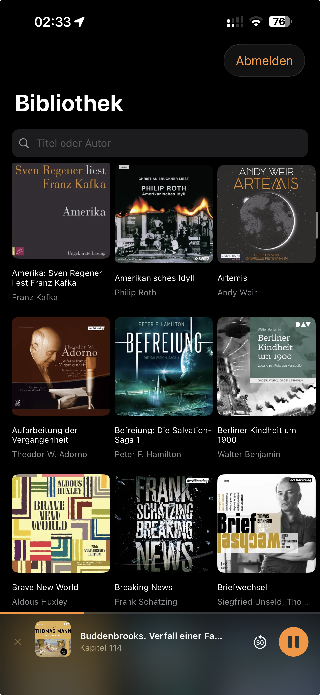
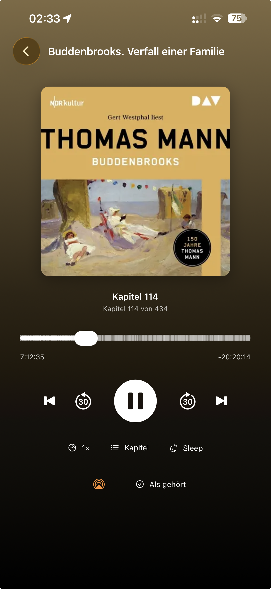
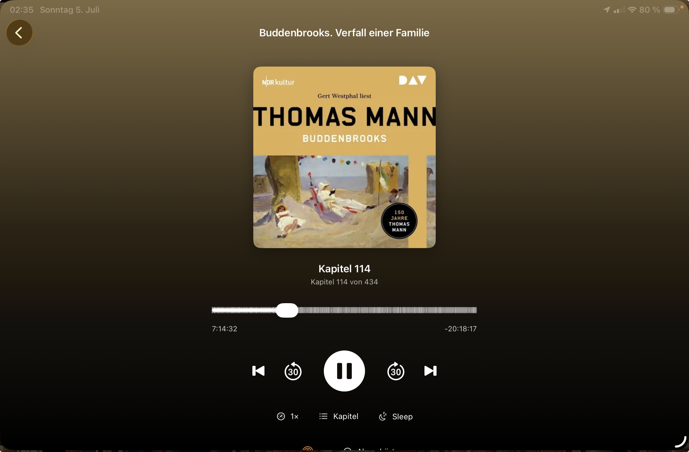

# Hörregal

A lightweight, open-source iOS/iPadOS client for [Audiobookshelf](https://www.audiobookshelf.org/).
The app focuses on one thing: **reliable playback progress sync** across multiple devices, without accidentally resetting a book to 0.

> The name refers to the “shelf” in Audiobookshelf — Hörregal is your audiobook shelf for iPhone and iPad. The Xcode project is still called `ABSPlayer` internally; “Hörregal” is only the display name.

Hörregal started as a private replacement for a client that regularly lost playback progress when switching devices. The app is intentionally minimal: no multi-user support, no podcasts, no server administration — just listening to audiobooks and keeping progress in sync.

> **Note:** This is a private hobby project without warranty. It is not affiliated with the Audiobookshelf project.

## Screenshots

| Library | Player (iPhone) | Player (iPad) |
|---|---|---|
|  |  |  |

## Features

- Login via API token, compatible with both the old and new Audiobookshelf authentication systems
- Library as an adaptive cover grid for iPhone and iPad, with a fixed search bar, sorting by title/author/recently added, and filters for all/unfinished/finished books
- “Continue Listening” and “Recently Added” sections
- Progress bar per book and “Finished” indicator
- Book detail page with description
- Persistent mini-player bar with its own progress bar; automatically restores the last listening session after a full app restart, paused and never auto-playing
- Audible-style player: large cover, cover-derived gradient background, chapter markers directly on the scrubber, play/pause/scrub/±30s/previous-next chapter, playback speed, sleep timer with fixed minutes or until chapter end, AirPlay, “Mark as listened,” and subtle haptic feedback
- Background audio, lock screen and Dynamic Island display including cover artwork
- **Offline download** per book, manually triggered with a Wi-Fi warning; local files are automatically preferred during playback — useful when your self-hosted server is accessed over the internet and latency becomes noticeable while travelling
- **Safe progress sync**; see below
- Multi-device progress reconciliation

## Core sync rule

This is the heart of the app. A user-triggered seek action — scrubber, chapter jump, ±30s, or lock screen control — is treated as intentional and synced immediately, even backwards. A warning dialog only appears if progress drops by more than 120 seconds **without user action**, for example due to a faulty client reset. If the user cancels, playback jumps back to the last stored position.

When switching devices, the app briefly checks the server before each playback start. If another device has the newer position, that server position is adopted instead of overwritten. True simultaneous listening on two devices is not covered; in that case, the last writer wins.

## Intentionally not included

Multi-user support, podcasts, metadata editing, and server/library administration.

## Requirements

- Xcode 15+ with Swift 5.9+, targeting iOS/iPadOS 17+
- A running Audiobookshelf server and an API token
- An Apple ID for signing; a free Apple ID is sufficient, see the note on 7-day signing below

## License

MIT — see [LICENSE](LICENSE).

---

## 1. Why no username/password login?

Newer Audiobookshelf versions, starting with v2.26.0, switched the authentication system to JWT with access and refresh tokens. For a minimal app, that would add unnecessary complexity such as cookie handling and token refresh logic.

How to find your token:

- **Older server versions:** Web interface → Settings → Users → select your account → the token is displayed.
- **Newer server versions:** Web interface → Settings → API Keys → create a new key.

If you are not sure which variant your server uses, try both. One of these paths will exist.

---

## 2. Create the Xcode project

1. Open Xcode → **File → New → Project**
2. Select **iOS → App**
3. Use these settings:
   - Product Name: `ABSPlayer`
   - Interface: **SwiftUI**
   - Language: **Swift**
   - Storage: **None**; no Core Data
   - Tests: can be unchecked; they are not needed here
4. Save the project locally
5. Select the project file → Target `ABSPlayer` → **General** tab → set **Minimum Deployments** to **iOS 17.0** because the code uses the newer `onChange` API

## 3. Add the files

1. In the Xcode project navigator, delete the automatically generated `ContentView.swift` file by choosing Move to Trash. Also delete the automatically generated `ABSPlayerApp.swift`.
2. Drag the complete `Sources` folder from this download into the Xcode project navigator, onto the top-level project entry.
3. In the dialog:
   - ✅ **Copy items if needed**
   - ✅ **Create groups**
   - ✅ Target “ABSPlayer” is checked
4. You should now see the groups `Models`, `Networking`, `ViewModels`, `Views`, and `ABSPlayerApp.swift` in Xcode.

## 4. Enable background audio

1. Select the project file → Target `ABSPlayer` → **Signing & Capabilities** tab
2. Add **+ Capability** → **Background Modes**
3. Check **Audio, AirPlay, and Picture in Picture**

Without this step, playback will pause when the screen locks or the app goes into the background.

## 5. Signing with a free Apple ID

1. In the same **Signing & Capabilities** tab:
   - **Team:** select your Apple ID; add it in Xcode → Settings → Accounts if needed
   - **Bundle Identifier:** use something unique, for example `de.yourname.absplayer`
2. In `KeychainStore.swift`, set the `service` constant to the same bundle identifier; look for the line containing `com.example.absplayer`.

**Important when using a free Apple ID without the Developer Program:** The app only runs on your device for 7 days. After that, you need to rebuild it once through Xcode by connecting the device and pressing ▶. For a purely private app, this is an acceptable compromise.

## 5b. Set the display name; optional

The name shown below the app icon can be set independently from the internal project name:

1. Project file → Target `ABSPlayer` → **General** tab
2. Set **Display Name** to `Hörregal`.

This makes the app appear as “Hörregal” on the home screen while the Xcode project remains named `ABSPlayer`. Renaming the internal project is fiddly and not worth it.

## 6. Build to your iPhone

1. Connect your iPhone via cable, or set up wireless debugging
2. Select your iPhone as the target device at the top of Xcode, not the simulator — background audio is much more reliable to test on real devices
3. Press ▶
4. On the iPhone, if necessary, go to **Settings → General → VPN & Device Management** and trust your Apple ID once

## 7. Log in inside the app

- Server: `your-server.example.com`; `https://` is added automatically
- API token: from step 1

---

## iPad support

The app is designed for iPhone and iPad. To make sure it can be installed on iPad, iPad needs to be enabled as a supported device for the target:

1. Project file → Target **ABSPlayer** → **General** tab
2. Under **Supported Destinations**, **iPad** should be listed. This is enabled by default for new SwiftUI projects. If not, click **+** and add iPad.
3. Under **Deployment Info**, check iPhone and iPad orientations. For an audiobook player, portrait and landscape are sufficient.

The layout adapts automatically: on iPad, the library shows a multi-column cover grid with more columns in landscape mode. The player and detail pages center their content in a readable column instead of stretching across the full width.

```text
Sources/
├── ABSPlayerApp.swift        Entry point
├── Models/                   Codable structs for the Audiobookshelf API
├── Networking/
│   ├── APIClient.swift       All HTTP calls
│   └── KeychainStore.swift   Secure storage for server URL and token
├── ViewModels/
│   ├── AuthViewModel.swift      Setup screen logic
│   ├── LibraryViewModel.swift   Loads book list and progress
│   ├── PlayerCoordinator.swift  Keeps the active session alive across navigation
│   │                            and provides the basis for the mini-player
│   └── PlayerViewModel.swift    AVPlayer, core sync rule, chapters, sleep timer
└── Views/
    ├── SetupView.swift        Server and token input
    ├── RootView.swift         Switches between setup and library
    ├── LibraryView.swift      Book list, search, sections
    ├── BookCoverView.swift    Cover with progress bar, reused across views
    ├── MiniPlayerBar.swift    Persistent bottom mini-player bar
    ├── PlayerScreen.swift     Full player, displays the coordinator session
    ├── PlayerView.swift       Audible-style player UI
    ├── CoverColorLoader.swift Extracts an accent color from the cover
    └── ChapterListView.swift  Chapter list as a sheet
```

**Mini-player architecture note:** `PlayerCoordinator` lives in `LibraryView` and survives navigation. Unlike before, playback is no longer stopped when leaving the player screen. Playback is only stopped explicitly, either when opening another book or by pressing the X in the mini-player bar.

API endpoints used:

| Purpose | Endpoint |
|---|---|
| Libraries | `GET /api/libraries` |
| Book list | `GET /api/libraries/{id}/items` |
| Book details, chapters and progress | `GET /api/items/{id}?expanded=1` |
| Write progress | `PATCH /api/me/progress/{itemId}` |
| Progress for the whole library | `GET /api/me` |
| Cover | `GET /api/items/{id}/cover?token=...` |
| Audio stream | direct `contentUrl` from the track data, with `Authorization: Bearer` header |

## About this project

Hörregal was created with support from Claude by Anthropic.
