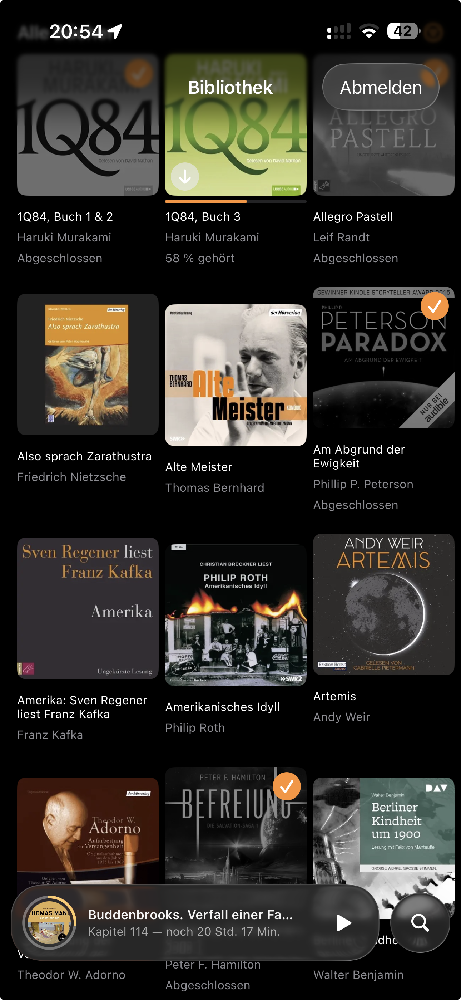
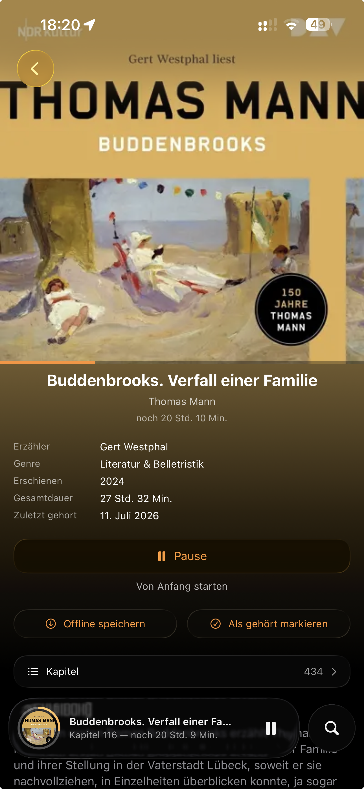
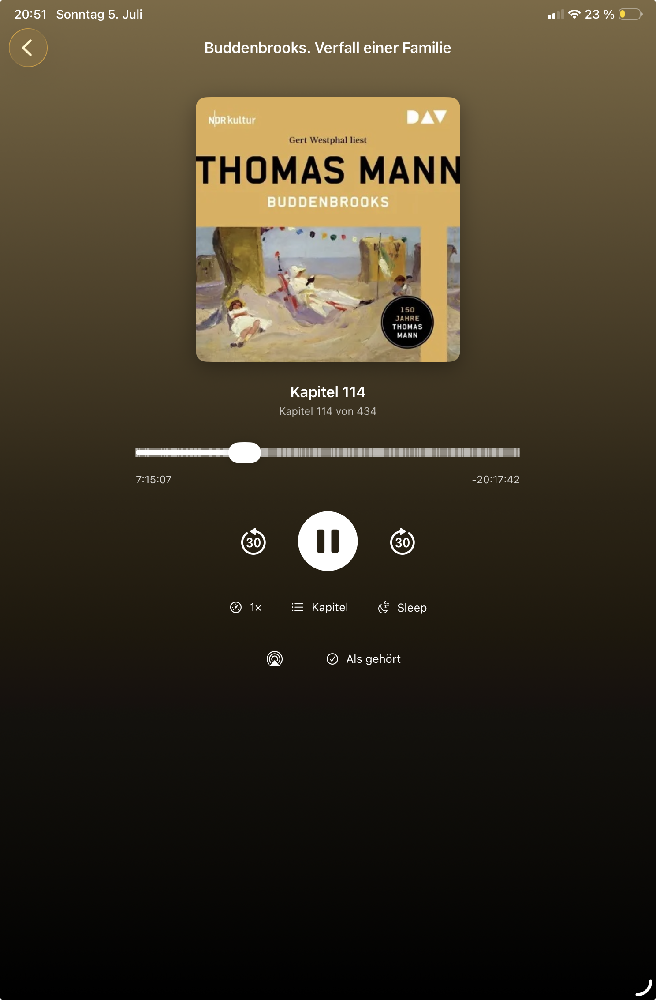

# Hörregal

A lightweight, open-source iOS/iPadOS client for [Audiobookshelf](https://www.audiobookshelf.org/).
The app focuses on one thing: **reliable playback progress sync** across multiple devices, without accidentally resetting a book to 0 — including while fully offline.

> The name refers to the “shelf” in Audiobookshelf — Hörregal is your audiobook shelf for iPhone and iPad. The Xcode project is still called `ABSPlayer` internally; “Hörregal” is only the display name.

Hörregal started as a private replacement for a client that regularly lost playback progress when switching devices. The app is intentionally minimal: no multi-user support, no podcasts, no server administration — just listening to audiobooks and keeping progress in sync, online or off.

> **Note:** This is a private hobby project without warranty. It is not affiliated with the Audiobookshelf project.

## Screenshots

| Bibliothek | Detail Book (iPhone) | Player (iPad) |
|---|---|---|
|  |  |  |

## Features

- Sign in with username/password or an API token, compatible with both the old and new Audiobookshelf authentication systems
- Library as an adaptive cover grid for iPhone and iPad, self-sizing to always fit the actual screen width without overlap, even across rotation
- Floating search button (Music-app style) that expands into a search field instead of a fixed search bar
- Sorting by title, author, recently added, or recently listened, with an ascending/descending toggle; sort and filter choices are remembered across app launches
- Filters for all/unfinished/finished books
- “Continue Listening”, “Recently Added”, and “Downloaded” sections
- Haptic Touch context menu on covers for quick actions: play, download, mark as heard
- Progress bar, “Finished” checkmark, and download-status badge directly on each cover; finished books are shown slightly desaturated
- Book detail page with description, narrator, series, genres, publication year, and total duration; download and “Mark as heard” directly from the detail page, with a play/pause button that correctly reflects and controls an already-playing session
- Persistent floating mini-player styled after Apple's Liquid Glass design (iOS 26, with a safe fallback material on older versions), with a circular progress ring around the cover; extra transport controls (skip forward/back, AirPlay) appear only on iPad or in landscape, keeping more room for the title on iPhone portrait; automatically restores the last listening session after a full app restart, paused and never auto-playing
- Full player as a rounded Liquid Glass sheet floating above the library — drag it down (grab handle or side zones) to dismiss back to the mini-player, with the library showing through the glass during the pull; large cover, cover-derived gradient background, chapter markers directly on the scrubber, play/pause/scrub, configurable skip interval (15/30/60 s, also applied to lock screen and mini-player buttons), playback speed remembered per book, sleep timer with fixed minutes or until chapter end, AirPlay, “Mark as listened”, and subtle haptic feedback; in landscape (iPhone and iPad) the cover moves next to the controls
- Transient glass pill for sync/source events (“resumed from server”, “offline — queued”, “progress saved”, “conflict detected”) shown above the mini-player or in the full player, auto-hiding after a few seconds
- Background audio, lock screen and Dynamic Island display including cover artwork
- **Multi-track playback**: audiobooks split across several audio files (not converted to a single M4B) play back-to-back seamlessly, with correct chapter and progress handling across the whole book
- **Offline download** per book, manually triggered with a Wi-Fi warning; downloads every track of a book, not just the first, continues while the app is in the background, shows a live progress ring on the cover badge, and caches its chapters/metadata locally — a downloaded book opens and plays fully offline, without needing to reach the server just to show its chapter list
- **Offline library**: when the server is unreachable, the library shows the downloaded (actually playable) books from the disk cache — covers of downloaded books are stored persistently, so they survive iOS cache purges; covers are cached at device-appropriate resolution without recompression
- **Offline sync queue**: a progress update that fails to send — whether offline or due to a server error — is queued on disk (atomically) and automatically retried on the next app start or as soon as the connection returns; before flushing, the queue reconciles against the server so a stale queued position never overwrites a newer one from another device
- Automatic reconnect detection: the library and any queued sync updates refresh by themselves once the connection comes back, without needing to background/foreground the app
- **Safe progress sync**; see below
- Multi-device progress reconciliation
- **Bookmarks** per book (position + title) synced through the Audiobookshelf bookmark API, created from the player, with offline queueing — bookmarks created or deleted without a connection are sent automatically once it returns
- Browse the library **by author or by genre** (via the sort/filter menu), reusing the same adaptive cover grid
- Settings screen: skip interval, default playback speed for new books, **Smart Rewind** (resume a little earlier after longer pauses), **auto-play the next unfinished book of a series**, appearance override (system/light/dark), Wi-Fi download warning toggle, storage management, sync status with a “Sync Now” button, a library picker for servers with several libraries, and the app version
- **Siri & Shortcuts**: “Continue listening in Hörregal” and “Play *book* in Hörregal” (book names come from the offline library cache), plus a home-screen quick action that resumes the last played book
- **Live Activity / Dynamic Island** prepared: playback state with chapter and self-advancing progress on the lock screen; requires adding the widget extension target once, see `LiveActivityWidget/ANLEITUNG.md`
- Adaptive light and dark design: the Liquid Glass chrome (mini player, search, toolbar buttons) takes a soft pastel wash of the current cover color in light mode, and the mini player dips off-screen and springs back when switching books
- Performance: grid cells decode a small derived thumbnail instead of the full cover — smooth scrolling and far less memory with large libraries; the book list is fetched in Audiobookshelf’s minified format
- Hardening: free-space check before downloads start, magic-byte container detection with automatic file-extension repair (unit-tested), automatic recovery when a track fails mid-playback instead of silent stalling, VoiceOver labels on all transport controls

## Core sync rule

This is the heart of the app. A user-triggered seek action — scrubber, chapter jump, ±30s, or lock screen control — is treated as intentional and synced immediately, even backwards. A warning dialog only appears if progress drops by more than 120 seconds **without user action**, for example due to a faulty client reset. If the user cancels, playback jumps back to the last stored position.

When switching devices, the app briefly checks the server before each playback start. The entry with the newer timestamp wins: if another device wrote last, its position is adopted — even if it is **further back** (e.g. after deliberately rewinding there). On older servers without a timestamp, only a further-ahead server position is adopted. True simultaneous listening on two devices is not covered; in that case, the last writer wins.

Every progress write always sends a complete record (current time, duration, and finished status together) rather than a partial update — a partial update leaves the server to guess what to do with the fields it wasn't given, which previously caused real progress loss when only the finished flag was toggled.

## Intentionally not included

Multi-user support, podcasts, metadata editing, and server/library administration.

## Requirements

- Xcode with an iOS 26 SDK available (needed to build at all, since the mini-player and search button use Apple's Liquid Glass API behind an availability check) with Swift 5.9+
- Deployment target iOS/iPadOS 17+ — the app still runs on older iOS versions at runtime, falling back to a plain translucent material instead of Liquid Glass
- A running Audiobookshelf server and either your account credentials or an API token
- An Apple ID for signing; a free Apple ID is sufficient, see the note on 7-day signing below

## License

MIT — see [LICENSE](LICENSE).

---

## 1. Sign-in options

The app signs in either with your Audiobookshelf **username and password** (the default — it exchanges them for a token via `/login` and stores only the token in the keychain) or directly with an **API token**.

Note for servers on the new JWT authentication (v2.26.0+): the password login receives a short-lived access token there, so the session can expire and return you to the setup screen. On such servers an API key is the more durable choice.

How to find your token:

- **Older server versions:** Web interface → Settings → Users → select your account → the token is displayed.
- **Newer server versions:** Web interface → Settings → API Keys → create a new key.

If you are not sure which variant your server uses, try both. One of these paths will exist.

---

## 2. Create the Xcode project

1. Open Xcode → **File → New → Project**
2. Select **iOS → App**
3. Use these settings:
   - Product Name: `ABSPlayer`
   - Interface: **SwiftUI**
   - Language: **Swift**
   - Storage: **None**; no Core Data
   - Tests: can be unchecked; they are not needed here
4. Save the project locally
5. Select the project file → Target `ABSPlayer` → **General** tab → set **Minimum Deployments** to **iOS 17.0**

## 3. Add the files

1. In the Xcode project navigator, delete the automatically generated `ContentView.swift` file by choosing Move to Trash. Also delete the automatically generated `ABSPlayerApp.swift`.
2. Drag the complete `Sources` folder from this download into the Xcode project navigator, onto the top-level project entry.
3. In the dialog:
   - ✅ **Copy items if needed**
   - ✅ **Create groups**
   - ✅ Target “ABSPlayer” is checked
4. You should now see the groups `Models`, `Networking`, `ViewModels`, `Views`, and `ABSPlayerApp.swift` in Xcode.

**If you're replacing files from a later update rather than doing a first-time setup:** don't drag new files on top of old ones with the same name still present — macOS will create a numbered duplicate (`File 2.swift`) instead of overwriting, and Xcode will then point at the wrong physical file. Either edit each changed file's content directly in Xcode, or delete the old group first (Move to Trash) and then drag the replacement in fresh.

## 4. Enable background audio

1. Select the project file → Target `ABSPlayer` → **Signing & Capabilities** tab
2. Add **+ Capability** → **Background Modes**
3. Check **Audio, AirPlay, and Picture in Picture**

Without this step, playback will pause when the screen locks or the app goes into the background.

## 5. Signing with a free Apple ID

1. In the same **Signing & Capabilities** tab:
   - **Team:** select your Apple ID; add it in Xcode → Settings → Accounts if needed
   - **Bundle Identifier:** use something unique, for example `de.yourname.absplayer`
2. In `KeychainStore.swift`, set the `service` constant to the same bundle identifier; look for the line containing `com.example.absplayer`.

**Important when using a free Apple ID without the Developer Program:** The app only runs on your device for 7 days. After that, you need to rebuild it once through Xcode by connecting the device and pressing ▶. For a purely private app, this is an acceptable compromise.

## 5b. Set the display name; optional

The name shown below the app icon can be set independently from the internal project name:

1. Project file → Target `ABSPlayer` → **General** tab
2. Set **Display Name** to `Hörregal`.

This makes the app appear as “Hörregal” on the home screen while the Xcode project remains named `ABSPlayer`. Renaming the internal project is fiddly and not worth it.

## 6. Build to your iPhone

1. Connect your iPhone via cable, or set up wireless debugging
2. Select your iPhone as the target device at the top of Xcode, not the simulator — background audio is much more reliable to test on real devices
3. Press ▶
4. On the iPhone, if necessary, go to **Settings → General → VPN & Device Management** and trust your Apple ID once

## 7. Log in inside the app

- Server: `your-server.example.com`; `https://` is added automatically
- Then either username + password, or an API token from step 1

---

## iPad support

The app is designed for iPhone and iPad. To make sure it can be installed on iPad, iPad needs to be enabled as a supported device for the target:

1. Project file → Target **ABSPlayer** → **General** tab
2. Under **Supported Destinations**, **iPad** should be listed. This is enabled by default for new SwiftUI projects. If not, click **+** and add iPad.
3. Under **Deployment Info**, check iPhone and iPad orientations. For an audiobook player, portrait and landscape are sufficient.

The library grid adapts automatically to the available width — more columns on iPad, even more in landscape — and recalculates cleanly on every rotation. On iPhone portrait, the mini-player hides its secondary transport buttons (skip forward/back, AirPlay) to leave more room for the book title; they reappear automatically on iPad or in iPhone landscape.

```text
Sources/
├── ABSPlayerApp.swift              Entry point + AppDelegate for background download events
├── AppShortcuts.swift              Siri App Intents (continue listening, play a specific book)
├── Models/
│   ├── AudiobookshelfModels.swift  Codable structs for the Audiobookshelf API
│   ├── SyncRules.swift             Pure, unit-tested sync decision rules + multi-track time math
│   ├── PlaybackActivityAttributes.swift  Shared Live-Activity contract (app + widget extension)
│   └── AppStorageKeys.swift        Central UserDefaults keys incl. per-book key cleanup
├── Networking/
│   ├── APIClient.swift             All HTTP calls
│   ├── KeychainStore.swift         Secure storage for server URL and token
│   ├── DownloadManager.swift       Multi-track offline downloads and their cached metadata
│   ├── FileDownloader.swift        Shared background URLSession download with progress reporting
│   ├── ImageCache.swift            Cover cache: memory + purgeable disk + persistent store for downloaded books
│   ├── NetworkMonitor.swift        Continuous connectivity observation (auto-reconnect)
│   ├── NetworkStatus.swift         One-shot Wi-Fi check and shared offline-error detection
│   ├── BookmarkQueue.swift         Offline queue + cache for bookmark create/delete
│   └── SyncQueue.swift             Persistent queue for failed progress updates (storage/API
│                                   behind protocols for testability)
├── ViewModels/
│   ├── AuthViewModel.swift         Setup screen logic
│   ├── LibraryViewModel.swift      Loads book list and progress, sorting, series grouping,
│   │                               offline disk cache
│   ├── PlayerCoordinator.swift     Keeps the active session alive across navigation,
│   │                               offline-aware, basis for the mini-player
│   ├── PlayerViewModel.swift       AVQueuePlayer, multi-track queue, seek/skip, chapters
│   ├── PlayerViewModel+Sync.swift  Sync policy: timer, reentrancy guard, conflicts, reconcile
│   ├── PlayerViewModel+SleepTimer.swift   Sleep timer incl. volume fade
│   ├── PlayerViewModel+LiveActivity.swift Live Activity start/update/end
│   └── PlayerViewModel+NowPlaying.swift   Lock screen commands, NowPlaying info, artwork
└── Views/
    ├── SetupView.swift             Server + password or token sign-in
    ├── SettingsView.swift          Playback, appearance, storage, sync, server settings
    ├── RootView.swift              Switches between setup and library
    ├── LibraryView.swift           Book list, search, sort/filter, sections, adaptive grid
    ├── FullPlayerOverlay.swift     Draggable Liquid Glass sheet hosting the full player
    ├── SeriesStackCell.swift       Series stack tile (fanned covers + count badge)
    ├── BookDetailScreen.swift      Book detail page, download, mark as heard, play/pause
    ├── BookCoverView.swift         Cover with progress bar and status badges, reused across views
    ├── BookGridComponents.swift    Shared grid cell + context menu, author/genre browse screens
    ├── BookmarksSheet.swift        Bookmark list/create/delete sheet in the player
    ├── CachedAsyncImage.swift      AsyncImage replacement backed by ImageCache
    ├── MiniPlayerBar.swift         Persistent floating glass mini-player
    ├── FloatingSearchButton.swift  Expanding search button
    ├── AdaptiveGlassBackground.swift  Shared Liquid Glass styling with material fallback
    ├── AirPlayButton.swift         AirPlay route picker wrapper
    ├── PlayerScreen.swift          Full player, displays the coordinator session
    ├── PlayerView.swift            Audible-style player UI
    ├── CoverColorLoader.swift      Extracts an accent color from the cover
    ├── ChapterListView.swift       Chapter list as a sheet
    └── Haptics.swift               Small haptic feedback helper
```

**Mini-player architecture note:** `PlayerCoordinator` lives in `LibraryView` and survives navigation. Playback is not stopped when leaving the player screen or when the mini-player is temporarily hidden (e.g. behind an expanded search field on iPhone) — it only stops when explicitly opening a different book.

API endpoints used:

| Purpose | Endpoint |
|---|---|
| Libraries | `GET /api/libraries` |
| Book list | `GET /api/libraries/{id}/items?minified=1` |
| Book details, chapters and progress | `GET /api/items/{id}?expanded=1` |
| Write progress | `PATCH /api/me/progress/{itemId}` |
| Progress for the whole library | `GET /api/me` |
| Password sign-in | `POST /login` |
| Bookmarks | `GET /api/me`, `POST/DELETE /api/me/item/{id}/bookmark…` |
| Cover | `GET /api/items/{id}/cover?token=...` |
| Audio stream | direct `contentUrl` from the track data, with `Authorization: Bearer` header |

## About this project

Hörregal was created with support from AI.
